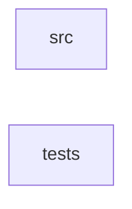

_Generated by CodeAtlas._

## Details

Owns 0 symbols across 1 file(s).

### src

Owns 101 symbols across 9 file(s).

**Related Classes/Methods:** _None_

**Source Files:**

- `core/src/context.rs`
  - `core.src.context.Context`
  - `core.src.context.Context.new`
  - `core.src.context.Context.with_relevance`
  - `core.src.context.ContextType`
  - `core.src.context.ContextWindow`
  - `core.src.context.ContextWindow.add_context`
  - `core.src.context.ContextWindow.is_full`
  - `core.src.context.ContextWindow.new`
  - `core.src.context.ContextWindow.remaining_tokens`
  - `core.src.context.estimate_tokens`
  - `core.src.context.tests.test_context_creation`
  - `core.src.context.tests.test_context_relevance`
  - `core.src.context.tests.test_context_window`
- `core/src/discovery.rs`
  - `core.src.discovery.Availability`
  - `core.src.discovery.DiscoveredSource`
  - `core.src.discovery.DiscoveredSource.new`
  - `core.src.discovery.DiscoveredSource.quality_score`
  - `core.src.discovery.DiscoveredSource.with_availability`
  - `core.src.discovery.DiscoveredSource.with_freshness`
  - `core.src.discovery.Discovery`
  - `core.src.discovery.Discovery.add_source`
  - `core.src.discovery.Discovery.new`
  - `core.src.discovery.Discovery.source_count`
  - `core.src.discovery.DiscoveryRanking`
  - `core.src.discovery.RankedSource`
  - `core.src.discovery.SourceType`
  - `core.src.discovery.tests.test_add_sources`
  - `core.src.discovery.tests.test_discovery_creation`
  - `core.src.discovery.tests.test_source_quality_score`
- `core/src/error.rs`
  - `core.src.error.Error`
- `core/src/executor.rs`
  - `core.src.executor.ExecutionResult`
  - `core.src.executor.ExecutionStatus`
  - `core.src.executor.ExecutionStatus.default`
  - `core.src.executor.QueryExecutor`
  - `core.src.executor.QueryExecutor.apply_optimization`
  - `core.src.executor.QueryExecutor.execute_query`
  - `core.src.executor.QueryExecutor.new`
  - `core.src.executor.tests.test_execute_query`
  - `core.src.executor.tests.test_execution_result_creation`
  - `core.src.executor.tests.test_executor_creation`
  - `core.src.executor.tests.test_optimization_techniques`
- `core/src/mcp.rs`
  - `core.src.mcp.MCPCapabilities`
  - `core.src.mcp.MCPCapabilities.all`
  - `core.src.mcp.MCPCapabilities.tools_only`
  - `core.src.mcp.MCPMessageType`
  - `core.src.mcp.MCPPrompt`
  - `core.src.mcp.MCPResource`
  - `core.src.mcp.MCPResource.new`
  - `core.src.mcp.MCPResource.with_description`
  - `core.src.mcp.MCPTool`
  - `core.src.mcp.MCPTool.cost_metrics`
  - `core.src.mcp.MCPTool.discover_context`
  - `core.src.mcp.MCPTool.query_optimizer`
  - `core.src.mcp.PromptArgument`
  - `core.src.mcp.tests.test_cost_metrics_tool`
  - `core.src.mcp.tests.test_discover_context_tool`
  - `core.src.mcp.tests.test_mcp_capabilities`
  - `core.src.mcp.tests.test_mcp_resource_creation`
  - `core.src.mcp.tests.test_query_optimizer_tool`
- `core/src/optimization.rs`
  - `core.src.optimization.CostMetrics`
  - `core.src.optimization.CostMetrics.exceeds_target`
  - `core.src.optimization.CostMetrics.meets_target`
  - `core.src.optimization.CostMetrics.new`
  - `core.src.optimization.CostMetrics.with_latency`
  - `core.src.optimization.CostMetrics.with_quality`
  - `core.src.optimization.OptimizationStrategy`
  - `core.src.optimization.OptimizationStrategy.add_technique`
  - `core.src.optimization.OptimizationStrategy.for_token_efficiency`
  - `core.src.optimization.OptimizationStrategy.new`
  - `core.src.optimization.OptimizationStrategy.with_expected_reduction`
  - `core.src.optimization.OptimizationTechnique`
  - `core.src.optimization.StrategyType`
  - `core.src.optimization.tests.test_cost_metrics`
  - `core.src.optimization.tests.test_cost_metrics_exceeds_target`
  - `core.src.optimization.tests.test_optimization_strategy`
  - `core.src.optimization.tests.test_token_efficiency_strategy`
- `core/src/query.rs`
  - `core.src.query.Query`
  - `core.src.query.Query.new`
  - `core.src.query.Query.token_efficient`
  - `core.src.query.Query.with_constraints`
  - `core.src.query.Query.with_intent`
  - `core.src.query.Query.with_max_tokens`
  - `core.src.query.QueryAction`
  - `core.src.query.QueryConstraints`
  - `core.src.query.QueryConstraints.default`
  - `core.src.query.QueryIntent`
  - `core.src.query.QueryPlan`
  - `core.src.query.QueryStep`
  - `core.src.query.tests.test_query_creation`
  - `core.src.query.tests.test_query_intent`
  - `core.src.query.tests.test_query_token_efficient`
- `core/src/statguardian.rs`
  - `core.src.statguardian.ValidationGate`
  - `core.src.statguardian.ValidationGate.allow_stale_for`
  - `core.src.statguardian.ValidationGate.block_on_failure`
  - `core.src.statguardian.ValidationGate.new`
  - `core.src.statguardian.ValidationResult`
  - `core.src.statguardian.ValidationResult.is_usable`
  - `core.src.statguardian.ValidationResult.is_valid`
  - `core.src.statguardian.ValidationStatus`
  - `core.src.statguardian.tests.test_validation_gate_creation`
  - `core.src.statguardian.tests.test_validation_result_valid`

### tests

Owns 30 symbols across 1 file(s).

**Related Classes/Methods:** _None_

**Source Files:**

- `core/tests/phase_v05_metadata_tests.rs`
  - `core.tests.phase_v05_metadata_tests.metadata_unit_tests.now_ts`
  - `core.tests.phase_v05_metadata_tests.metadata_unit_tests.test_bigquery_profile_exists`
  - `core.tests.phase_v05_metadata_tests.metadata_unit_tests.test_database_cost_consideration`
  - `core.tests.phase_v05_metadata_tests.metadata_unit_tests.test_database_freshness_matters`
  - `core.tests.phase_v05_metadata_tests.metadata_unit_tests.test_database_postgres_preferred`
  - `core.tests.phase_v05_metadata_tests.metadata_unit_tests.test_database_profiles_count`
  - `core.tests.phase_v05_metadata_tests.metadata_unit_tests.test_database_quality_matters`
  - `core.tests.phase_v05_metadata_tests.metadata_unit_tests.test_database_query_tool_exists`
  - `core.tests.phase_v05_metadata_tests.metadata_unit_tests.test_database_scoring`
  - `core.tests.phase_v05_metadata_tests.metadata_unit_tests.test_github_profile_exists`
  - `core.tests.phase_v05_metadata_tests.metadata_unit_tests.test_mcp_database_tool_preferred`
  - `core.tests.phase_v05_metadata_tests.metadata_unit_tests.test_mcp_tool_capability_matters`
  - `core.tests.phase_v05_metadata_tests.metadata_unit_tests.test_mcp_tool_cost_preference`
  - `core.tests.phase_v05_metadata_tests.metadata_unit_tests.test_mcp_tool_latency_preference`
  - `core.tests.phase_v05_metadata_tests.metadata_unit_tests.test_mcp_tool_profiles_count`
  - `core.tests.phase_v05_metadata_tests.metadata_unit_tests.test_mcp_tool_reliability_matters`
  - `core.tests.phase_v05_metadata_tests.metadata_unit_tests.test_mcp_tool_scoring`
  - `core.tests.phase_v05_metadata_tests.metadata_unit_tests.test_mongodb_profile_exists`
  - `core.tests.phase_v05_metadata_tests.metadata_unit_tests.test_official_documentation_highest_scores`
  - `core.tests.phase_v05_metadata_tests.metadata_unit_tests.test_postgres_profile_exists`
  - `core.tests.phase_v05_metadata_tests.metadata_unit_tests.test_profile_scoring_consistency`
  - `core.tests.phase_v05_metadata_tests.metadata_unit_tests.test_search_tool_profile_exists`
  - `core.tests.phase_v05_metadata_tests.metadata_unit_tests.test_stackoverflow_profile_exists`
  - `core.tests.phase_v05_metadata_tests.metadata_unit_tests.test_web_domain_authority_varied`
  - `core.tests.phase_v05_metadata_tests.metadata_unit_tests.test_web_freshness_scoring`
  - `core.tests.phase_v05_metadata_tests.metadata_unit_tests.test_web_high_quality_scores_high`
  - `core.tests.phase_v05_metadata_tests.metadata_unit_tests.test_web_no_ssl_penalizes_score`
  - `core.tests.phase_v05_metadata_tests.metadata_unit_tests.test_web_profile_scoring`
  - `core.tests.phase_v05_metadata_tests.metadata_unit_tests.test_web_profile_tags`
  - `core.tests.phase_v05_metadata_tests.metadata_unit_tests.test_web_profiles_count`
