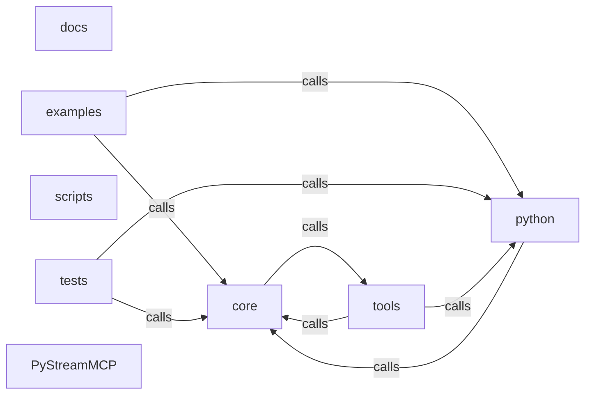

_Generated by CodeAtlas._

## Details

Architecture map of PyStreamMCP.

### core

Owns 0 symbols across 1 file(s).

**Related Classes/Methods:** _None_

### docs

Owns 0 symbols across 1 file(s).

**Related Classes/Methods:** _None_

### examples

Owns 16 symbols across 8 file(s).

**Related Classes/Methods:** _None_

**Source Files:**

- `examples/basic_usage.py`
  - `examples.basic_usage.main`
- `examples/langchain_agent_advanced.py`
  - `examples.langchain_agent_advanced.example_basic_agent`
  - `examples.langchain_agent_advanced.example_custom_tools`
  - `examples.langchain_agent_advanced.example_multistep_workflow`
  - `examples.langchain_agent_advanced.example_rag_with_retriever`
  - `examples.langchain_agent_advanced.example_streaming_responses`
- `examples/langchain_integration.py`
  - `examples.langchain_integration.example_pystreammcp_tool`
  - `examples.langchain_integration.example_retrieval_workflow`
  - `examples.langchain_integration.example_with_mock_llm`
- `examples/llamaindex_integration.py`
  - `examples.llamaindex_integration.example_comparison`
  - `examples.llamaindex_integration.example_index_creation`
  - `examples.llamaindex_integration.example_query_engine`
  - `examples.llamaindex_integration.example_retriever`
  - `examples.llamaindex_integration.example_with_documents`
- `examples/mcp_orchestrator.py`
  - `examples.mcp_orchestrator.main`
- `examples/mcp_pystreammcp.py`
  - `examples.mcp_pystreammcp.main`

### python

Owns 0 symbols across 1 file(s).

**Related Classes/Methods:** _None_

### scripts

Owns 0 symbols across 3 file(s).

**Related Classes/Methods:** _None_

### tests

Owns 594 symbols across 26 file(s).

**Related Classes/Methods:** _None_

**Source Files:**

- `tests/conftest.py`
  - `tests.conftest.failing_adapter`
  - `tests.conftest.failing_agent`
  - `tests.conftest.llm_failure`
  - `tests.conftest.mock_adapter`
- `tests/metadata_filtering_tests.rs`
  - `tests.metadata_filtering_tests.metadata_filtering_benchmarks.bench_cache_lookup`
  - `tests.metadata_filtering_tests.metadata_filtering_benchmarks.bench_end_to_end_filtering`
  - `tests.metadata_filtering_tests.metadata_filtering_benchmarks.bench_metadata_quality_score`
  - `tests.metadata_filtering_tests.metadata_filtering_benchmarks.bench_query_feature_extraction`
  - `tests.metadata_filtering_tests.metadata_filtering_benchmarks.bench_ranking_100_candidates`
  - `tests.metadata_filtering_tests.metadata_filtering_tests.test_concurrent_cache_access`
  - `tests.metadata_filtering_tests.metadata_filtering_tests.test_database_metadata_quality_calculation`
  - `tests.metadata_filtering_tests.metadata_filtering_tests.test_end_to_end_metadata_filtering`
  - `tests.metadata_filtering_tests.metadata_filtering_tests.test_estimated_tokens_calculation`
  - `tests.metadata_filtering_tests.metadata_filtering_tests.test_mcp_tool_metadata_quality_calculation`
  - `tests.metadata_filtering_tests.metadata_filtering_tests.test_metadata_cache_clear`
  - `tests.metadata_filtering_tests.metadata_filtering_tests.test_metadata_cache_eviction`
  - `tests.metadata_filtering_tests.metadata_filtering_tests.test_metadata_cache_expiry`
  - `tests.metadata_filtering_tests.metadata_filtering_tests.test_metadata_cache_memory_usage`
  - `tests.metadata_filtering_tests.metadata_filtering_tests.test_metadata_cache_set_get`
  - `tests.metadata_filtering_tests.metadata_filtering_tests.test_metadata_cache_size_limit`
  - `tests.metadata_filtering_tests.metadata_filtering_tests.test_metadata_filter_ranking_database`
  - `tests.metadata_filtering_tests.metadata_filtering_tests.test_metadata_filter_ranking_mcp_tools`
  - `tests.metadata_filtering_tests.metadata_filtering_tests.test_metadata_filter_ranking_web`
  - `tests.metadata_filtering_tests.metadata_filtering_tests.test_metadata_justification_strings`
  - `tests.metadata_filtering_tests.metadata_filtering_tests.test_quality_weighting`
  - `tests.metadata_filtering_tests.metadata_filtering_tests.test_query_feature_extraction`
  - `tests.metadata_filtering_tests.metadata_filtering_tests.test_ranking_strategy_balanced`
  - `tests.metadata_filtering_tests.metadata_filtering_tests.test_ranking_strategy_cost_optimized`
  - `tests.metadata_filtering_tests.metadata_filtering_tests.test_ranking_strategy_freshness`
  - `tests.metadata_filtering_tests.metadata_filtering_tests.test_ranking_strategy_quality`
  - `tests.metadata_filtering_tests.metadata_filtering_tests.test_selective_retrieval_top_k`
  - `tests.metadata_filtering_tests.metadata_filtering_tests.test_web_metadata_quality_calculation`
- `tests/selective_retrieval_tests.rs`
  - `tests.selective_retrieval_tests.quality_explainability_tests.test_budget_allocation_explanation`
  - `tests.selective_retrieval_tests.quality_explainability_tests.test_quality_preservation`
  - `tests.selective_retrieval_tests.quality_explainability_tests.test_reranking_justification`
  - `tests.selective_retrieval_tests.quality_explainability_tests.test_zero_false_negatives`
  - `tests.selective_retrieval_tests.selective_retrieval_benchmarks.bench_budget_calculation`
  - `tests.selective_retrieval_tests.selective_retrieval_benchmarks.bench_complexity_detection`
  - `tests.selective_retrieval_tests.selective_retrieval_benchmarks.bench_end_to_end_pipeline`
  - `tests.selective_retrieval_tests.selective_retrieval_benchmarks.bench_intent_classification`
  - `tests.selective_retrieval_tests.selective_retrieval_benchmarks.bench_multiplier_calculation`
  - `tests.selective_retrieval_tests.selective_retrieval_benchmarks.bench_rerank_100_items`
  - `tests.selective_retrieval_tests.selective_retrieval_benchmarks.bench_select_within_budget`
  - `tests.selective_retrieval_tests.selective_retrieval_tests.test_budget_statistics`
  - `tests.selective_retrieval_tests.selective_retrieval_tests.test_combined_reranking_score`
  - `tests.selective_retrieval_tests.selective_retrieval_tests.test_complexity_complex`
  - `tests.selective_retrieval_tests.selective_retrieval_tests.test_complexity_moderate`
  - `tests.selective_retrieval_tests.selective_retrieval_tests.test_complexity_simple`
  - `tests.selective_retrieval_tests.selective_retrieval_tests.test_complexity_very_complex`
  - `tests.selective_retrieval_tests.selective_retrieval_tests.test_contextual_reranking`
  - `tests.selective_retrieval_tests.selective_retrieval_tests.test_end_to_end_filtering_complex`
  - `tests.selective_retrieval_tests.selective_retrieval_tests.test_end_to_end_filtering_simple`
  - `tests.selective_retrieval_tests.selective_retrieval_tests.test_final_budget_calculation`
  - `tests.selective_retrieval_tests.selective_retrieval_tests.test_informativeness_scoring`
  - `tests.selective_retrieval_tests.selective_retrieval_tests.test_intent_allocation_complex`
  - `tests.selective_retrieval_tests.selective_retrieval_tests.test_intent_allocation_conceptual`
  - `tests.selective_retrieval_tests.selective_retrieval_tests.test_intent_allocation_detailed`
  - `tests.selective_retrieval_tests.selective_retrieval_tests.test_intent_allocation_factual`
  - `tests.selective_retrieval_tests.selective_retrieval_tests.test_intent_complex`
  - `tests.selective_retrieval_tests.selective_retrieval_tests.test_intent_conceptual`
  - `tests.selective_retrieval_tests.selective_retrieval_tests.test_intent_detailed`
  - `tests.selective_retrieval_tests.selective_retrieval_tests.test_intent_factual`
  - `tests.selective_retrieval_tests.selective_retrieval_tests.test_keyword_extraction`
  - `tests.selective_retrieval_tests.selective_retrieval_tests.test_multiplier_ceiling`
  - `tests.selective_retrieval_tests.selective_retrieval_tests.test_multiplier_critical`
  - `tests.selective_retrieval_tests.selective_retrieval_tests.test_multiplier_debug`
  - `tests.selective_retrieval_tests.selective_retrieval_tests.test_multiplier_emergency`
  - `tests.selective_retrieval_tests.selective_retrieval_tests.test_multiplier_financial`
  - `tests.selective_retrieval_tests.selective_retrieval_tests.test_multiplier_highest_wins`
  - `tests.selective_retrieval_tests.selective_retrieval_tests.test_recency_scoring`
  - `tests.selective_retrieval_tests.selective_retrieval_tests.test_relevance_scoring`
  - `tests.selective_retrieval_tests.selective_retrieval_tests.test_select_within_budget`
  - `tests.selective_retrieval_tests.selective_retrieval_tests.test_strict_mode_enforcement`
  - `tests.selective_retrieval_tests.selective_retrieval_tests.test_tier_assignment_complex`
  - `tests.selective_retrieval_tests.selective_retrieval_tests.test_tier_assignment_moderate`
  - `tests.selective_retrieval_tests.selective_retrieval_tests.test_tier_assignment_simple`
  - `tests.selective_retrieval_tests.selective_retrieval_tests.test_tier_assignment_very_complex`
  - `tests.selective_retrieval_tests.selective_retrieval_tests.test_uniqueness_scoring`
  - `tests.selective_retrieval_tests.selective_retrieval_tests.test_warning_at_threshold`
  - `tests.selective_retrieval_tests.stage1_stage2_integration_tests.test_concurrent_selective_retrieval`
  - `tests.selective_retrieval_tests.stage1_stage2_integration_tests.test_data_reduction_database`
  - `tests.selective_retrieval_tests.stage1_stage2_integration_tests.test_data_reduction_mcp_tool`
  - `tests.selective_retrieval_tests.stage1_stage2_integration_tests.test_data_reduction_web`
  - `tests.selective_retrieval_tests.stage1_stage2_integration_tests.test_two_stage_pipeline`
- `tests/test_cli.py`
  - `tests.test_cli.test_cli_group_lists_the_real_subcommands`
  - `tests.test_cli.test_cli_query_json_output_has_real_fields`
  - `tests.test_cli.test_cli_query_missing_text_errors`
  - `tests.test_cli.test_cli_version_command`
  - `tests.test_cli.test_cli_version_option`
- `tests/test_codeatlas_adapter.py`
  - `tests.test_codeatlas_adapter._run`
  - `tests.test_codeatlas_adapter.test_check_reports_the_embedded_engine_available`
  - `tests.test_codeatlas_adapter.test_diagnose_summarises_the_architecture_map`
  - `tests.test_codeatlas_adapter.test_explain_reports_an_unknown_node_as_an_error`
  - `tests.test_codeatlas_adapter.test_god_nodes_are_ranked_by_degree`
- `tests/test_discovery.py`
  - `tests.test_discovery.test_api_discover_endpoint_uses_real_registry`
  - `tests.test_discovery.test_discover_ranks_by_real_token_overlap`
  - `tests.test_discovery.test_discover_respects_limit`
  - `tests.test_discovery.test_discover_typed_returns_real_discovered_sources`
  - `tests.test_discovery.test_discover_with_no_overlap_returns_empty_not_padded`
  - `tests.test_discovery.test_discover_with_no_sources_returns_empty`
  - `tests.test_discovery.test_mcp_discover_tool_uses_real_registry_not_fake_source_n`
  - `tests.test_discovery.test_unregister_removes_source_from_results`
- `tests/test_integration_phase2.py`
  - `tests.test_integration_phase2.TestCrossMCPOrchestration`
  - `tests.test_integration_phase2.TestCrossMCPOrchestration.multi_mcp_setup`
  - `tests.test_integration_phase2.TestCrossMCPOrchestration.test_cascade_execution_cross_mcp`
  - `tests.test_integration_phase2.TestCrossMCPOrchestration.test_fallback_manager_when_tool_unavailable`
  - `tests.test_integration_phase2.TestCrossMCPOrchestration.test_multi_stage_cascade`
  - `tests.test_integration_phase2.TestCrossMCPOrchestration.test_tool_discovery_across_mcps`
  - `tests.test_integration_phase2.TestCrossMCPOrchestration.test_tool_lookup_performance`
  - `tests.test_integration_phase2.TestCrossMCPOrchestration.test_tool_routing_healthy_mcp`
  - `tests.test_integration_phase2.TestHealthAndResilience`
  - `tests.test_integration_phase2.TestHealthAndResilience.health_setup`
  - `tests.test_integration_phase2.TestHealthAndResilience.test_critical_metrics_detection`
  - `tests.test_integration_phase2.TestHealthAndResilience.test_critical_metrics_detection.has_critical_metrics`
  - `tests.test_integration_phase2.TestHealthAndResilience.test_graceful_degradation_one_mcp_down`
  - `tests.test_integration_phase2.TestHealthAndResilience.test_health_metrics_collection`
  - `tests.test_integration_phase2.TestHealthAndResilience.test_status_transitions`
  - `tests.test_integration_phase2.TestStatGuardianPyStreamMCPIntegration`
  - `tests.test_integration_phase2.TestStatGuardianPyStreamMCPIntegration.orchestration_setup`
  - `tests.test_integration_phase2.TestStatGuardianPyStreamMCPIntegration.test_anomaly_detection_records_for_analysis`
  - `tests.test_integration_phase2.TestStatGuardianPyStreamMCPIntegration.test_drift_detection_triggers_alert_cascade`
  - `tests.test_integration_phase2.TestStatGuardianPyStreamMCPIntegration.test_quality_violation_triggers_hold_activation`
  - `tests.test_integration_phase2.TestStatGuardianPyStreamMCPIntegration.test_schema_change_cascades_to_lineage_system`
  - `tests.test_integration_phase2.TestWebhookSecurityAndReliability`
  - `tests.test_integration_phase2.TestWebhookSecurityAndReliability.test_audit_trail_completeness`
  - `tests.test_integration_phase2.TestWebhookSecurityAndReliability.test_audit_trail_completeness.record_event`
  - `tests.test_integration_phase2.TestWebhookSecurityAndReliability.test_event_deduplication_logic`
  - `tests.test_integration_phase2.TestWebhookSecurityAndReliability.test_event_deduplication_logic.is_duplicate`
  - `tests.test_integration_phase2.TestWebhookSecurityAndReliability.test_exponential_backoff_retry_schedule`
  - `tests.test_integration_phase2.TestWebhookSecurityAndReliability.test_exponential_backoff_retry_schedule.calculate_retry_schedule`
  - `tests.test_integration_phase2.TestWebhookSecurityAndReliability.test_webhook_signature_validation`
- `tests/test_langchain_integration.py`
  - `tests.test_langchain_integration.TestAgentCreation`
  - `tests.test_langchain_integration.TestAgentCreation.test_agent_creation_requires_langchain`
  - `tests.test_langchain_integration.TestIntegrationFlow`
  - `tests.test_langchain_integration.TestIntegrationFlow.test_multiple_tool_invocations`
  - `tests.test_langchain_integration.TestIntegrationFlow.test_tool_in_workflow`
  - `tests.test_langchain_integration.TestPyStreamMCPRetriever`
  - `tests.test_langchain_integration.TestPyStreamMCPRetriever.test_documents_have_metrics`
  - `tests.test_langchain_integration.TestPyStreamMCPRetriever.test_get_relevant_documents`
  - `tests.test_langchain_integration.TestPyStreamMCPRetriever.test_retriever_creation`
  - `tests.test_langchain_integration.TestPyStreamMCPTool`
  - `tests.test_langchain_integration.TestPyStreamMCPTool.test_cost_reduction_validation`
  - `tests.test_langchain_integration.TestPyStreamMCPTool.test_tool_creation`
  - `tests.test_langchain_integration.TestPyStreamMCPTool.test_tool_intent_mapping`
  - `tests.test_langchain_integration.TestPyStreamMCPTool.test_tool_metrics`
  - `tests.test_langchain_integration.TestPyStreamMCPTool.test_tool_query_execution`
- `tests/test_llamaindex_integration.py`
  - `tests.test_llamaindex_integration.TestIndexCreation`
  - `tests.test_llamaindex_integration.TestIndexCreation.test_index_creation_with_optional_args`
  - `tests.test_llamaindex_integration.TestIndexCreation.test_index_creation_without_documents`
  - `tests.test_llamaindex_integration.TestIndexCreation.test_index_retrieval`
  - `tests.test_llamaindex_integration.TestIntegrationFlow`
  - `tests.test_llamaindex_integration.TestIntegrationFlow.test_cost_accumulation`
  - `tests.test_llamaindex_integration.TestIntegrationFlow.test_optimization_target_met`
  - `tests.test_llamaindex_integration.TestIntegrationFlow.test_query_engine_workflow`
  - `tests.test_llamaindex_integration.TestIntegrationFlow.test_retriever_workflow`
  - `tests.test_llamaindex_integration.TestStreamMCPQueryEngine`
  - `tests.test_llamaindex_integration.TestStreamMCPQueryEngine.test_cost_reduction_validation`
  - `tests.test_llamaindex_integration.TestStreamMCPQueryEngine.test_query_engine_creation`
  - `tests.test_llamaindex_integration.TestStreamMCPQueryEngine.test_query_execution`
  - `tests.test_llamaindex_integration.TestStreamMCPQueryEngine.test_query_result_metadata`
  - `tests.test_llamaindex_integration.TestStreamMCPRetriever`
  - `tests.test_llamaindex_integration.TestStreamMCPRetriever.test_node_score_based_on_cost_reduction`
  - `tests.test_llamaindex_integration.TestStreamMCPRetriever.test_retrieve_documents`
  - `tests.test_llamaindex_integration.TestStreamMCPRetriever.test_retrieved_nodes_have_metadata`
  - `tests.test_llamaindex_integration.TestStreamMCPRetriever.test_retriever_creation`
  - `tests.test_llamaindex_integration.TestStreamMCPRetriever.test_retriever_with_different_strategies`
- `tests/test_mcp_connector_discovery.py`
  - `tests.test_mcp_connector_discovery.TestDetectCompatibleProjects`
  - `tests.test_mcp_connector_discovery.TestDetectCompatibleProjects.test_finds_projects_with_matching_capability`
  - `tests.test_mcp_connector_discovery.TestDetectCompatibleProjects.test_no_matching_capability_returns_empty`
  - `tests.test_mcp_connector_discovery.TestDiscoverMcpProjects`
  - `tests.test_mcp_connector_discovery.TestDiscoverMcpProjects.test_healthy_endpoint_returns_its_real_tools`
  - `tests.test_mcp_connector_discovery.TestDiscoverMcpProjects.test_mixed_healthy_and_unreachable_endpoints`
  - `tests.test_mcp_connector_discovery.TestDiscoverMcpProjects.test_no_config_file_returns_real_empty_result`
  - `tests.test_mcp_connector_discovery.TestDiscoverMcpProjects.test_refresh_false_reuses_cached_results`
  - `tests.test_mcp_connector_discovery.TestDiscoverMcpProjects.test_refresh_false_reuses_cached_results.handler`
  - `tests.test_mcp_connector_discovery.TestDiscoverMcpProjects.test_unreachable_endpoint_is_reported_unavailable_not_faked`
  - `tests.test_mcp_connector_discovery.TestManageEndpointFederation`
  - `tests.test_mcp_connector_discovery.TestManageEndpointFederation.test_list_does_not_reprobe`
  - `tests.test_mcp_connector_discovery.TestManageEndpointFederation.test_list_does_not_reprobe.handler`
  - `tests.test_mcp_connector_discovery.TestManageEndpointFederation.test_refresh_reprobes`
  - `tests.test_mcp_connector_discovery.TestManageEndpointFederation.test_refresh_reprobes.handler`
  - `tests.test_mcp_connector_discovery.TestManageEndpointFederation.test_unknown_action_is_a_real_error`
  - `tests.test_mcp_connector_discovery.TestRankToolsByRelevance`
  - `tests.test_mcp_connector_discovery.TestRankToolsByRelevance._orchestrator_with_tools`
  - `tests.test_mcp_connector_discovery.TestRankToolsByRelevance.test_no_task_terms_yields_no_matches`
  - `tests.test_mcp_connector_discovery.TestRankToolsByRelevance.test_ranks_matching_tools_above_unrelated_ones`
  - `tests.test_mcp_connector_discovery.TestRankToolsByRelevance.test_relevance_scores_are_bounded`
  - `tests.test_mcp_connector_discovery.TestRankToolsByRelevance.test_sorts_by_descending_relevance_when_multiple_tools_match`
  - `tests.test_mcp_connector_discovery.mock_transport`
  - `tests.test_mcp_connector_discovery.mock_transport.handler`
  - `tests.test_mcp_connector_discovery.write_config`
- `tests/test_mcp_server_resilience.py`
  - `tests.test_mcp_server_resilience.TestArgumentValidation`
  - `tests.test_mcp_server_resilience.TestArgumentValidation.test_input_schema_matches_actual_validation`
  - `tests.test_mcp_server_resilience.TestArgumentValidation.test_invalid_enum_value_is_rejected`
  - `tests.test_mcp_server_resilience.TestArgumentValidation.test_missing_required_field_is_rejected`
  - `tests.test_mcp_server_resilience.TestArgumentValidation.test_negative_max_tokens_is_rejected`
  - `tests.test_mcp_server_resilience.TestArgumentValidation.test_out_of_range_limit_is_rejected`
  - `tests.test_mcp_server_resilience.TestArgumentValidation.test_register_source_requires_both_name_and_description`
  - `tests.test_mcp_server_resilience.TestArgumentValidation.test_valid_arguments_succeed`
  - `tests.test_mcp_server_resilience.TestArgumentValidation.test_wrong_type_is_rejected`
  - `tests.test_mcp_server_resilience.TestCrawlTool`
  - `tests.test_mcp_server_resilience.TestCrawlTool.test_crawl_is_advertised_with_schema`
  - `tests.test_mcp_server_resilience.TestCrawlTool.test_crawl_missing_dependency_returns_structured_error`
  - `tests.test_mcp_server_resilience.TestCrawlTool.test_crawl_rejects_missing_url`
  - `tests.test_mcp_server_resilience.TestCrawlTool.test_crawl_shapes_a_real_mudfish_result`
  - `tests.test_mcp_server_resilience.TestCrawlTool.test_crawl_shapes_a_real_mudfish_result._Page`
  - `tests.test_mcp_server_resilience.TestCrawlTool.test_crawl_shapes_a_real_mudfish_result._Page.__init__`
  - `tests.test_mcp_server_resilience.TestCrawlTool.test_crawl_shapes_a_real_mudfish_result._Result`
  - `tests.test_mcp_server_resilience.TestCrawlTool.test_crawl_shapes_a_real_mudfish_result._Result.__init__`
  - `tests.test_mcp_server_resilience.TestCrawlTool.test_crawl_shapes_a_real_mudfish_result._Result.__iter__`
  - `tests.test_mcp_server_resilience.TestCrawlTool.test_crawl_shapes_a_real_mudfish_result._Result.stats`
  - `tests.test_mcp_server_resilience.TestCrawlTool.test_crawl_shapes_a_real_mudfish_result._Stats`
  - `tests.test_mcp_server_resilience.TestCrawlTool.test_crawl_shapes_a_real_mudfish_result._fake_crawl`
  - `tests.test_mcp_server_resilience.TestLLMFailureStateIsolation`
  - `tests.test_mcp_server_resilience.TestLLMFailureStateIsolation.test_a_healthy_tool_call_still_works_after_a_failing_one`
  - `tests.test_mcp_server_resilience.TestLLMFailureStateIsolation.test_optimize_tool_also_isolates_failures`
  - `tests.test_mcp_server_resilience.TestLLMFailureStateIsolation.test_process_message_survives_tool_execution_failure`
  - `tests.test_mcp_server_resilience.TestLLMFailureStateIsolation.test_process_message_survives_unknown_tool_name`
  - `tests.test_mcp_server_resilience.TestLLMFailureStateIsolation.test_tool_execution_failure_returns_structured_error_not_a_crash`
  - `tests.test_mcp_server_resilience.TestMockAdapterIsReusable`
  - `tests.test_mcp_server_resilience.TestMockAdapterIsReusable.test_mock_adapter_async_methods_work`
  - `tests.test_mcp_server_resilience.TestMockAdapterIsReusable.test_mock_adapter_discover_returns_sources`
  - `tests.test_mcp_server_resilience.TestMockAdapterIsReusable.test_mock_adapter_query_returns_valid_result`
- `tests/test_mcp_tools_handler.py`
  - `tests.test_mcp_tools_handler.TestCacheManagement`
  - `tests.test_mcp_tools_handler.TestCacheManagement.test_stats_reflect_real_empty_cache_not_fabricated_numbers`
  - `tests.test_mcp_tools_handler.TestCacheManagement.test_unknown_action_is_a_real_error`
  - `tests.test_mcp_tools_handler.TestDiscoverMcpProjects`
  - `tests.test_mcp_tools_handler.TestDiscoverMcpProjects.test_filter_by_capability_uses_real_detection`
  - `tests.test_mcp_tools_handler.TestDiscoverMcpProjects.test_no_config_returns_real_empty_result_not_fixture`
  - `tests.test_mcp_tools_handler.TestHandleCrossDatabaseJoin`
  - `tests.test_mcp_tools_handler.TestHandleCrossDatabaseJoin.test_reports_not_implemented_not_fabricated_row_count`
  - `tests.test_mcp_tools_handler.TestListServiceEndpoints`
  - `tests.test_mcp_tools_handler.TestListServiceEndpoints.test_empty_registry_is_genuinely_empty`
  - `tests.test_mcp_tools_handler.TestListServiceEndpoints.test_reflects_real_registered_endpoint`
  - `tests.test_mcp_tools_handler.TestOptimizeCrossProjectQuery`
  - `tests.test_mcp_tools_handler.TestOptimizeCrossProjectQuery.test_reduction_derives_from_actual_query_text`
  - `tests.test_mcp_tools_handler.TestOrchestrateCrossMcpWorkflow`
  - `tests.test_mcp_tools_handler.TestOrchestrateCrossMcpWorkflow.test_actually_executes_not_just_plans`
  - `tests.test_mcp_tools_handler.TestOrchestrateCrossMcpWorkflow.test_fail_fast_stops_on_first_missing_tool`
  - `tests.test_mcp_tools_handler.TestRouteToolInvocation`
  - `tests.test_mcp_tools_handler.TestRouteToolInvocation.test_registered_tool_routes_to_its_real_project`
  - `tests.test_mcp_tools_handler.TestRouteToolInvocation.test_unknown_tool_reports_real_failure_not_fake_success`
  - `tests.test_mcp_tools_handler.handler`
  - `tests.test_mcp_tools_handler.orchestrator`
- `tests/test_okf_core.py`
  - `tests.test_okf_core.TestOKFCatalogOperations`
  - `tests.test_okf_core.TestOKFCatalogOperations.test_catalog_directory_structure`
  - `tests.test_okf_core.TestOKFCatalogOperations.test_find_by_type`
  - `tests.test_okf_core.TestOKFCatalogOperations.test_get_cost_profile`
  - `tests.test_okf_core.TestOKFCatalogOperations.test_search_systems_all`
  - `tests.test_okf_core.TestOKFCatalogOperations.test_search_systems_by_name`
  - `tests.test_okf_core.TestOKFCatalogOperations.test_search_systems_by_tag`
  - `tests.test_okf_core.TestOKFCatalogOperations.test_search_tools_all`
  - `tests.test_okf_core.TestOKFDocumentLoading`
  - `tests.test_okf_core.TestOKFDocumentLoading.test_create_and_load_document`
  - `tests.test_okf_core.TestOKFDocumentLoading.test_document_content_parsing`
  - `tests.test_okf_core.TestOKFDocumentLoading.test_document_links_extraction`
  - `tests.test_okf_core.TestOKFDocumentLoading.test_document_metadata_parsing`
  - `tests.test_okf_core.TestOKFDocumentSaving`
  - `tests.test_okf_core.TestOKFDocumentSaving.test_save_document_with_metadata`
  - `tests.test_okf_core.TestOKFDocumentSaving.test_save_persists_to_disk`
  - `tests.test_okf_core.TestOKFLinking`
  - `tests.test_okf_core.TestOKFLinking.test_document_references`
  - `tests.test_okf_core.TestOKFLinking.test_system_linkage`
  - `tests.test_okf_core.TestOKFReload`
  - `tests.test_okf_core.TestOKFReload.test_reload_syncs_index`
  - `tests.test_okf_core.populated_catalog`
  - `tests.test_okf_core.temp_catalog`
- `tests/test_okf_discovery.py`
  - `tests.test_okf_discovery.TestDiscoveryOKFExporter`
  - `tests.test_okf_discovery.TestDiscoveryOKFExporter.test_export_query_plan`
  - `tests.test_okf_discovery.TestDiscoveryOKFExporter.test_export_system`
  - `tests.test_okf_discovery.TestDiscoveryOKFExporter.test_export_tool`
  - `tests.test_okf_discovery.TestDiscoveryOKFExporter.test_full_export_workflow`
  - `tests.test_okf_discovery.TestMCPSystemToOKF`
  - `tests.test_okf_discovery.TestMCPSystemToOKF.test_render_system`
  - `tests.test_okf_discovery.TestMCPSystemToOKF.test_render_system_with_tags`
  - `tests.test_okf_discovery.TestMCPToolToOKF`
  - `tests.test_okf_discovery.TestMCPToolToOKF.test_render_tool`
  - `tests.test_okf_discovery.TestMCPToolToOKF.test_render_tool_minimal`
  - `tests.test_okf_discovery.temp_catalog`
- `tests/test_okf_query_planner.py`
  - `tests.test_okf_query_planner.TestOKFQueryPlanner`
  - `tests.test_okf_query_planner.TestOKFQueryPlanner.test_cheapest_path`
  - `tests.test_okf_query_planner.TestOKFQueryPlanner.test_fastest_path`
  - `tests.test_okf_query_planner.TestOKFQueryPlanner.test_generate_plan`
  - `tests.test_okf_query_planner.TestOKFQueryPlanner.test_generate_plan_with_constraint`
  - `tests.test_okf_query_planner.TestOKFQueryPlanner.test_optimal_path`
  - `tests.test_okf_query_planner.TestOKFQueryPlanner.test_optimal_with_custom_weights`
  - `tests.test_okf_query_planner.TestOKFQueryPlanner.test_plan_with_budget_constraint`
  - `tests.test_okf_query_planner.TestOKFQueryPlanner.test_plan_with_no_matching_systems`
  - `tests.test_okf_query_planner.TestOKFQueryPlannerIntegration`
  - `tests.test_okf_query_planner.TestOKFQueryPlannerIntegration.test_end_to_end_planning`
  - `tests.test_okf_query_planner.TestOKFQueryPlannerIntegration.test_plans_differ_by_strategy`
  - `tests.test_okf_query_planner.TestQueryPlan`
  - `tests.test_okf_query_planner.TestQueryPlan.test_empty_plan`
  - `tests.test_okf_query_planner.TestQueryPlan.test_plan_to_dict`
  - `tests.test_okf_query_planner.TestQueryPlan.test_plan_with_steps`
  - `tests.test_okf_query_planner.TestQueryPlanStep`
  - `tests.test_okf_query_planner.TestQueryPlanStep.test_create_step`
  - `tests.test_okf_query_planner.TestQueryPlanStep.test_step_to_dict`
  - `tests.test_okf_query_planner.populated_catalog`
- `tests/test_phase3_advanced.py`
  - `tests.test_phase3_advanced.TestMetricsCollector`
  - `tests.test_phase3_advanced.TestMetricsCollector.test_collector_initialization`
  - `tests.test_phase3_advanced.TestMetricsCollector.test_export_prometheus`
  - `tests.test_phase3_advanced.TestMetricsCollector.test_flush_buffer`
  - `tests.test_phase3_advanced.TestMetricsCollector.test_get_summary`
  - `tests.test_phase3_advanced.TestMetricsCollector.test_record_error`
  - `tests.test_phase3_advanced.TestMetricsCollector.test_record_model_accuracy`
  - `tests.test_phase3_advanced.TestMetricsCollector.test_record_query`
  - `tests.test_phase3_advanced.TestModelTrainer`
  - `tests.test_phase3_advanced.TestModelTrainer.test_load_production_data`
  - `tests.test_phase3_advanced.TestModelTrainer.test_train_and_validate`
  - `tests.test_phase3_advanced.TestModelTrainer.test_trainer_initialization`
  - `tests.test_phase3_advanced.TestModelTrainer.test_training_history`
  - `tests.test_phase3_advanced.TestPhase3Integration`
  - `tests.test_phase3_advanced.TestPhase3Integration.test_ml_observability_pipeline`
  - `tests.test_phase3_advanced.TestRelevanceModel`
  - `tests.test_phase3_advanced.TestRelevanceModel.test_add_training_sample`
  - `tests.test_phase3_advanced.TestRelevanceModel.test_export_import_model`
  - `tests.test_phase3_advanced.TestRelevanceModel.test_model_initialization`
  - `tests.test_phase3_advanced.TestRelevanceModel.test_model_training`
  - `tests.test_phase3_advanced.TestRelevanceModel.test_predict_relevance`
  - `tests.test_phase3_advanced.TestRelevanceModel.test_query_features`
  - `tests.test_phase3_advanced.TestRelevanceModel.test_rank_sources`
- `tests/test_phase3_items12.py`
  - `tests.test_phase3_items12.TestAdvancedOptimization`
  - `tests.test_phase3_items12.TestAdvancedOptimization.test_engine_init`
  - `tests.test_phase3_items12.TestAdvancedOptimization.test_multi_agent_optimization`
  - `tests.test_phase3_items12.TestAdvancedOptimization.test_optimization_history`
  - `tests.test_phase3_items12.TestAdvancedOptimization.test_single_agent_optimization`
  - `tests.test_phase3_items12.TestAdvancedOptimization.test_speedup_estimation_multi`
  - `tests.test_phase3_items12.TestAdvancedOptimization.test_speedup_estimation_single`
  - `tests.test_phase3_items12.TestAutoPromptTagging`
  - `tests.test_phase3_items12.TestAutoPromptTagging.test_batch_analyze`
  - `tests.test_phase3_items12.TestAutoPromptTagging.test_classifier_init`
  - `tests.test_phase3_items12.TestAutoPromptTagging.test_complexity_moderate`
  - `tests.test_phase3_items12.TestAutoPromptTagging.test_complexity_simple`
  - `tests.test_phase3_items12.TestAutoPromptTagging.test_domain_detection`
  - `tests.test_phase3_items12.TestAutoPromptTagging.test_intent_detection_analyze`
  - `tests.test_phase3_items12.TestAutoPromptTagging.test_intent_detection_retrieve`
  - `tests.test_phase3_items12.TestAutoPromptTagging.test_quality_score`
  - `tests.test_phase3_items12.TestAutoPromptTagging.test_routing_strategy`
  - `tests.test_phase3_items12.TestAutoPromptTagging.test_tag_generation`
  - `tests.test_phase3_items12.TestAutoPromptTagging.test_training`
  - `tests.test_phase3_items12.TestMultiAgentContextSharing`
  - `tests.test_phase3_items12.TestMultiAgentContextSharing.test_cleanup_expired`
  - `tests.test_phase3_items12.TestMultiAgentContextSharing.test_create_shared_context`
  - `tests.test_phase3_items12.TestMultiAgentContextSharing.test_request_context`
  - `tests.test_phase3_items12.TestMultiAgentContextSharing.test_reuse_tracking`
  - `tests.test_phase3_items12.TestMultiAgentContextSharing.test_sharing_init`
  - `tests.test_phase3_items12.TestMultiAgentContextSharing.test_ttl_expiration`
  - `tests.test_phase3_items12.TestPhase3Completion`
  - `tests.test_phase3_items12.TestPhase3Completion.test_streaming_with_sharing`
  - `tests.test_phase3_items12.TestPhase3Completion.test_tagging_to_optimization`
  - `tests.test_phase3_items12.TestStreamingContextWindow`
  - `tests.test_phase3_items12.TestStreamingContextWindow.test_close_stream`
  - `tests.test_phase3_items12.TestStreamingContextWindow.test_create_stream`
  - `tests.test_phase3_items12.TestStreamingContextWindow.test_multiple_chunks`
  - `tests.test_phase3_items12.TestStreamingContextWindow.test_stream_chunk`
  - `tests.test_phase3_items12.TestStreamingContextWindow.test_streaming_init`
- `tests/test_phase3_items345.py`
  - `tests.test_phase3_items345.TestLangSmithIntegration`
  - `tests.test_phase3_items345.TestLangSmithIntegration.test_cost_analytics`
  - `tests.test_phase3_items345.TestLangSmithIntegration.test_dashboard_data`
  - `tests.test_phase3_items345.TestLangSmithIntegration.test_export_to_langsmith`
  - `tests.test_phase3_items345.TestLangSmithIntegration.test_start_end_span`
  - `tests.test_phase3_items345.TestLangSmithIntegration.test_start_trace`
  - `tests.test_phase3_items345.TestLangSmithIntegration.test_trace_query`
  - `tests.test_phase3_items345.TestLangSmithIntegration.test_tracer_initialization`
  - `tests.test_phase3_items345.TestPhase3Integration`
  - `tests.test_phase3_items345.TestPhase3Integration.test_decomposition_with_qa`
  - `tests.test_phase3_items345.TestPhase3Integration.test_langsmith_with_decomposition`
  - `tests.test_phase3_items345.TestQAFramework`
  - `tests.test_phase3_items345.TestQAFramework.test_add_custom_rule`
  - `tests.test_phase3_items345.TestQAFramework.test_audit_logger`
  - `tests.test_phase3_items345.TestQAFramework.test_audit_trail_filtering`
  - `tests.test_phase3_items345.TestQAFramework.test_compliance_report`
  - `tests.test_phase3_items345.TestQAFramework.test_sla_checker`
  - `tests.test_phase3_items345.TestQAFramework.test_sla_violation`
  - `tests.test_phase3_items345.TestQAFramework.test_validate_failing`
  - `tests.test_phase3_items345.TestQAFramework.test_validate_passing`
  - `tests.test_phase3_items345.TestQAFramework.test_validation_summary`
  - `tests.test_phase3_items345.TestQAFramework.test_validator_initialization`
  - `tests.test_phase3_items345.TestQueryDecomposition`
  - `tests.test_phase3_items345.TestQueryDecomposition.test_analyze_aggregated_query`
  - `tests.test_phase3_items345.TestQueryDecomposition.test_analyze_joined_query`
  - `tests.test_phase3_items345.TestQueryDecomposition.test_analyze_simple_query`
  - `tests.test_phase3_items345.TestQueryDecomposition.test_decompose_joined`
  - `tests.test_phase3_items345.TestQueryDecomposition.test_decompose_simple`
  - `tests.test_phase3_items345.TestQueryDecomposition.test_decomposer_initialization`
  - `tests.test_phase3_items345.TestQueryDecomposition.test_estimate_speedup`
  - `tests.test_phase3_items345.TestQueryDecomposition.test_execution_order`
- `tests/test_sprint1_foundation.py`
  - `tests.test_sprint1_foundation.MockAdapter`
  - `tests.test_sprint1_foundation.MockAdapter.discover`
  - `tests.test_sprint1_foundation.MockAdapter.discover_async`
  - `tests.test_sprint1_foundation.MockAdapter.optimize`
  - `tests.test_sprint1_foundation.MockAdapter.optimize_async`
  - `tests.test_sprint1_foundation.MockAdapter.query`
  - `tests.test_sprint1_foundation.MockAdapter.query_async`
  - `tests.test_sprint1_foundation.TestAdapterPattern`
  - `tests.test_sprint1_foundation.TestAdapterPattern._restore_adapter_registry`
  - `tests.test_sprint1_foundation.TestAdapterPattern.test_adapter_config`
  - `tests.test_sprint1_foundation.TestAdapterPattern.test_adapter_get_tools`
  - `tests.test_sprint1_foundation.TestAdapterPattern.test_adapter_registry_create`
  - `tests.test_sprint1_foundation.TestAdapterPattern.test_adapter_registry_get`
  - `tests.test_sprint1_foundation.TestAdapterPattern.test_adapter_registry_list`
  - `tests.test_sprint1_foundation.TestAdapterPattern.test_adapter_registry_register`
  - `tests.test_sprint1_foundation.TestAdapterPattern.test_mock_adapter_query`
  - `tests.test_sprint1_foundation.TestMCPServer`
  - `tests.test_sprint1_foundation.TestMCPServer.test_mcp_server_discover_tool`
  - `tests.test_sprint1_foundation.TestMCPServer.test_mcp_server_init`
  - `tests.test_sprint1_foundation.TestMCPServer.test_mcp_server_invalid_tool`
  - `tests.test_sprint1_foundation.TestMCPServer.test_mcp_server_message_handling`
  - `tests.test_sprint1_foundation.TestMCPServer.test_mcp_server_optimize_tool`
  - `tests.test_sprint1_foundation.TestMCPServer.test_mcp_server_query_tool`
  - `tests.test_sprint1_foundation.TestMCPServer.test_mcp_server_tools`
  - `tests.test_sprint1_foundation.TestRestAPI`
  - `tests.test_sprint1_foundation.TestRestAPI.api`
  - `tests.test_sprint1_foundation.TestRestAPI.client`
  - `tests.test_sprint1_foundation.TestRestAPI.test_create_agent`
  - `tests.test_sprint1_foundation.TestRestAPI.test_get_agent`
  - `tests.test_sprint1_foundation.TestRestAPI.test_health_endpoint`
  - `tests.test_sprint1_foundation.TestRestAPI.test_info_endpoint`
  - `tests.test_sprint1_foundation.TestRestAPI.test_list_agents`
  - `tests.test_sprint1_foundation.TestRestAPI.test_metrics_endpoint`
  - `tests.test_sprint1_foundation.TestRestAPI.test_query_endpoint`
- `tests/test_sprint2_langchain.py`
  - `tests.test_sprint2_langchain.TestCostMetrics`
  - `tests.test_sprint2_langchain.TestCostMetrics.test_cost_reduction_calculation`
  - `tests.test_sprint2_langchain.TestCostMetrics.test_execution_time_tracking`
  - `tests.test_sprint2_langchain.TestErrorHandling`
  - `tests.test_sprint2_langchain.TestErrorHandling.test_empty_query`
  - `tests.test_sprint2_langchain.TestErrorHandling.test_special_characters`
  - `tests.test_sprint2_langchain.TestErrorHandling.test_very_long_query`
  - `tests.test_sprint2_langchain.TestLangchainAdapter`
  - `tests.test_sprint2_langchain.TestLangchainAdapter.test_adapter_async_discover`
  - `tests.test_sprint2_langchain.TestLangchainAdapter.test_adapter_async_query`
  - `tests.test_sprint2_langchain.TestLangchainAdapter.test_adapter_discover`
  - `tests.test_sprint2_langchain.TestLangchainAdapter.test_adapter_get_retriever`
  - `tests.test_sprint2_langchain.TestLangchainAdapter.test_adapter_get_tool_for_langchain`
  - `tests.test_sprint2_langchain.TestLangchainAdapter.test_adapter_initialization`
  - `tests.test_sprint2_langchain.TestLangchainAdapter.test_adapter_optimize`
  - `tests.test_sprint2_langchain.TestLangchainAdapter.test_adapter_query`
  - `tests.test_sprint2_langchain.TestLegacyInterfaces`
  - `tests.test_sprint2_langchain.TestLegacyInterfaces.test_pystreammcp_retriever`
  - `tests.test_sprint2_langchain.TestLegacyInterfaces.test_pystreammcp_retriever_langchain_wrapper`
  - `tests.test_sprint2_langchain.TestLegacyInterfaces.test_pystreammcp_tool_call`
  - `tests.test_sprint2_langchain.TestLegacyInterfaces.test_pystreammcp_tool_initialization`
  - `tests.test_sprint2_langchain.TestLegacyInterfaces.test_pystreammcp_tool_langchain_wrapper`
  - `tests.test_sprint2_langchain.TestWorkflows`
  - `tests.test_sprint2_langchain.TestWorkflows.test_adapter_registry_integration`
  - `tests.test_sprint2_langchain.TestWorkflows.test_async_batch_workflow`
  - `tests.test_sprint2_langchain.TestWorkflows.test_multistep_workflow`
- `tests/test_sprint3_rag_frameworks.py`
  - `tests.test_sprint3_rag_frameworks.TestCostMetrics`
  - `tests.test_sprint3_rag_frameworks.TestCostMetrics.test_llamaindex_cost_reduction`
  - `tests.test_sprint3_rag_frameworks.TestCostMetrics.test_semantic_kernel_cost_reduction`
  - `tests.test_sprint3_rag_frameworks.TestLlamaIndexAdapter`
  - `tests.test_sprint3_rag_frameworks.TestLlamaIndexAdapter.test_adapter_async_discover`
  - `tests.test_sprint3_rag_frameworks.TestLlamaIndexAdapter.test_adapter_async_query`
  - `tests.test_sprint3_rag_frameworks.TestLlamaIndexAdapter.test_adapter_discover`
  - `tests.test_sprint3_rag_frameworks.TestLlamaIndexAdapter.test_adapter_get_retriever`
  - `tests.test_sprint3_rag_frameworks.TestLlamaIndexAdapter.test_adapter_initialization`
  - `tests.test_sprint3_rag_frameworks.TestLlamaIndexAdapter.test_adapter_optimize`
  - `tests.test_sprint3_rag_frameworks.TestLlamaIndexAdapter.test_adapter_query`
  - `tests.test_sprint3_rag_frameworks.TestLlamaIndexAdapter.test_adapter_registry`
  - `tests.test_sprint3_rag_frameworks.TestLlamaIndexAdapter.test_legacy_retriever`
  - `tests.test_sprint3_rag_frameworks.TestMultiAdapterWorkflows`
  - `tests.test_sprint3_rag_frameworks.TestMultiAdapterWorkflows.test_concurrent_adapter_execution`
  - `tests.test_sprint3_rag_frameworks.TestMultiAdapterWorkflows.test_llamaindex_to_semantic_kernel_pipeline`
  - `tests.test_sprint3_rag_frameworks.TestSemanticKernelAdapter`
  - `tests.test_sprint3_rag_frameworks.TestSemanticKernelAdapter.test_adapter_async_discover`
  - `tests.test_sprint3_rag_frameworks.TestSemanticKernelAdapter.test_adapter_async_query`
  - `tests.test_sprint3_rag_frameworks.TestSemanticKernelAdapter.test_adapter_discover`
  - `tests.test_sprint3_rag_frameworks.TestSemanticKernelAdapter.test_adapter_get_native_plugin`
  - `tests.test_sprint3_rag_frameworks.TestSemanticKernelAdapter.test_adapter_initialization`
  - `tests.test_sprint3_rag_frameworks.TestSemanticKernelAdapter.test_adapter_optimize`
  - `tests.test_sprint3_rag_frameworks.TestSemanticKernelAdapter.test_adapter_query`
  - `tests.test_sprint3_rag_frameworks.TestSemanticKernelAdapter.test_adapter_registry`
  - `tests.test_sprint3_rag_frameworks.TestSemanticKernelAdapter.test_legacy_plugin`
- `tests/test_sprint4_agent_frameworks.py`
  - `tests.test_sprint4_agent_frameworks.TestCrewAIAdapter`
  - `tests.test_sprint4_agent_frameworks.TestCrewAIAdapter.test_crewai_adapter_init`
  - `tests.test_sprint4_agent_frameworks.TestCrewAIAdapter.test_crewai_legacy_tool`
  - `tests.test_sprint4_agent_frameworks.TestCrewAIAdapter.test_crewai_query`
  - `tests.test_sprint4_agent_frameworks.TestHaystackAdapter`
  - `tests.test_sprint4_agent_frameworks.TestHaystackAdapter.test_haystack_adapter_init`
  - `tests.test_sprint4_agent_frameworks.TestHaystackAdapter.test_haystack_discover`
  - `tests.test_sprint4_agent_frameworks.TestHaystackAdapter.test_haystack_query`
  - `tests.test_sprint4_agent_frameworks.TestMultiAgentWorkflows`
  - `tests.test_sprint4_agent_frameworks.TestMultiAgentWorkflows.test_concurrent_agent_execution`
  - `tests.test_sprint4_agent_frameworks.TestMultiAgentWorkflows.test_crewai_multi_agent_coordination`
  - `tests.test_sprint4_agent_frameworks.TestPydanticAIAdapter`
  - `tests.test_sprint4_agent_frameworks.TestPydanticAIAdapter.test_pydantic_ai_adapter_init`
  - `tests.test_sprint4_agent_frameworks.TestPydanticAIAdapter.test_pydantic_ai_async`
  - `tests.test_sprint4_agent_frameworks.TestPydanticAIAdapter.test_pydantic_ai_query`
  - `tests.test_sprint4_agent_frameworks.TestRegistryIntegration`
  - `tests.test_sprint4_agent_frameworks.TestRegistryIntegration.test_all_adapters_registered`
- `tests/test_sprint5_orchestration.py`
  - `tests.test_sprint5_orchestration.TestAirflowIntegration`
  - `tests.test_sprint5_orchestration.TestAirflowIntegration.test_dag_factory_discovery_dag`
  - `tests.test_sprint5_orchestration.TestAirflowIntegration.test_dag_factory_pipeline_dag`
  - `tests.test_sprint5_orchestration.TestAirflowIntegration.test_dag_factory_query_dag`
  - `tests.test_sprint5_orchestration.TestAirflowIntegration.test_discovery_operator_finds_real_registered_source`
  - `tests.test_sprint5_orchestration.TestAirflowIntegration.test_discovery_operator_returns_nothing_without_registration`
  - `tests.test_sprint5_orchestration.TestAirflowIntegration.test_optimize_operator`
  - `tests.test_sprint5_orchestration.TestAirflowIntegration.test_query_operator`
  - `tests.test_sprint5_orchestration.TestN8nIntegration`
  - `tests.test_sprint5_orchestration.TestN8nIntegration.test_n8n_webhook_discovery_finds_real_registered_source`
  - `tests.test_sprint5_orchestration.TestN8nIntegration.test_n8n_webhook_discovery_returns_nothing_without_registration`
  - `tests.test_sprint5_orchestration.TestN8nIntegration.test_n8n_webhook_missing_params`
  - `tests.test_sprint5_orchestration.TestN8nIntegration.test_n8n_webhook_query`
  - `tests.test_sprint5_orchestration.TestN8nIntegration.test_n8n_webhook_spec`
  - `tests.test_sprint5_orchestration.TestOrchestrationWorkflows`
  - `tests.test_sprint5_orchestration.TestOrchestrationWorkflows.test_airflow_pipeline_execution`
  - `tests.test_sprint5_orchestration.TestOrchestrationWorkflows.test_temporal_multi_step_workflow`
  - `tests.test_sprint5_orchestration.TestPowerAutomateIntegration`
  - `tests.test_sprint5_orchestration.TestPowerAutomateIntegration.test_power_automate_connector_spec`
  - `tests.test_sprint5_orchestration.TestPowerAutomateIntegration.test_power_automate_query`
  - `tests.test_sprint5_orchestration.TestRPAIntegration`
  - `tests.test_sprint5_orchestration.TestRPAIntegration.test_automation_anywhere_batch`
  - `tests.test_sprint5_orchestration.TestRPAIntegration.test_automation_anywhere_spec`
  - `tests.test_sprint5_orchestration.TestRPAIntegration.test_uipath_activity_spec`
  - `tests.test_sprint5_orchestration.TestRPAIntegration.test_uipath_query_activity`
  - `tests.test_sprint5_orchestration.TestTemporalIntegration`
  - `tests.test_sprint5_orchestration.TestTemporalIntegration.test_temporal_client`
  - `tests.test_sprint5_orchestration.TestTemporalIntegration.test_temporal_discovery_activity_finds_real_registered_source`
  - `tests.test_sprint5_orchestration.TestTemporalIntegration.test_temporal_discovery_activity_returns_nothing_without_registration`
  - `tests.test_sprint5_orchestration.TestTemporalIntegration.test_temporal_query_activity`
  - `tests.test_sprint5_orchestration.TestTemporalIntegration.test_temporal_workflow_definition`
  - `tests.test_sprint5_orchestration.TestTemporalIntegration.test_temporal_workflow_execution`
  - `tests.test_sprint5_orchestration.TestTemporalIntegration.test_temporal_workflow_status`
- `tests/test_statguardian_integration.py`
  - `tests.test_statguardian_integration.TestIntegrationWithDiscovery`
  - `tests.test_statguardian_integration.TestIntegrationWithDiscovery.test_quality_gating_in_discovery`
  - `tests.test_statguardian_integration.TestQualityValidator`
  - `tests.test_statguardian_integration.TestQualityValidator.test_add_error`
  - `tests.test_statguardian_integration.TestQualityValidator.test_add_quality_check`
  - `tests.test_statguardian_integration.TestQualityValidator.test_cache_validation_result`
  - `tests.test_statguardian_integration.TestQualityValidator.test_clear_all_cache`
  - `tests.test_statguardian_integration.TestQualityValidator.test_clear_cache`
  - `tests.test_statguardian_integration.TestQualityValidator.test_get_stats`
  - `tests.test_statguardian_integration.TestQualityValidator.test_quality_check_bounds`
  - `tests.test_statguardian_integration.TestQualityValidator.test_register_gate`
  - `tests.test_statguardian_integration.TestQualityValidator.test_should_include_invalid_blocking`
  - `tests.test_statguardian_integration.TestQualityValidator.test_should_include_invalid_nonblocking`
  - `tests.test_statguardian_integration.TestQualityValidator.test_should_include_valid`
  - `tests.test_statguardian_integration.TestQualityValidator.test_validate_data_quality`
  - `tests.test_statguardian_integration.TestQualityValidator.test_validate_schema_validation`
  - `tests.test_statguardian_integration.TestQualityValidator.test_validate_with_gate_not_registered`
  - `tests.test_statguardian_integration.TestQualityValidator.test_validate_with_statguardian_disabled`
  - `tests.test_statguardian_integration.TestQualityValidator.test_validation_gate_configuration`
  - `tests.test_statguardian_integration.TestQualityValidator.test_validation_result_bounds`
  - `tests.test_statguardian_integration.TestQualityValidator.test_validation_result_degraded`
  - `tests.test_statguardian_integration.TestQualityValidator.test_validation_result_invalid`
  - `tests.test_statguardian_integration.TestQualityValidator.test_validation_result_stale_usable`
  - `tests.test_statguardian_integration.TestQualityValidator.test_validation_result_valid`
  - `tests.test_statguardian_integration.TestQualityValidator.test_validator_creation`
- `tests/test_webhook_hmac_auth.py`
  - `tests.test_webhook_hmac_auth.TestSignatureHelpers`
  - `tests.test_webhook_hmac_auth.TestSignatureHelpers.test_compute_and_verify_round_trip`
  - `tests.test_webhook_hmac_auth.TestSignatureHelpers.test_missing_secret_fails_closed`
  - `tests.test_webhook_hmac_auth.TestSignatureHelpers.test_tampered_payload_fails_verification`
  - `tests.test_webhook_hmac_auth.TestWebhookEndpointAcceptsAuthenticated`
  - `tests.test_webhook_hmac_auth.TestWebhookEndpointAcceptsAuthenticated.test_correctly_signed_request_is_accepted_and_processed`
  - `tests.test_webhook_hmac_auth.TestWebhookEndpointAcceptsAuthenticated.test_env_var_secret_is_picked_up_when_not_passed_explicitly`
  - `tests.test_webhook_hmac_auth.TestWebhookEndpointRejectsUnauthenticated`
  - `tests.test_webhook_hmac_auth.TestWebhookEndpointRejectsUnauthenticated.test_no_secret_configured_rejects_everything`
  - `tests.test_webhook_hmac_auth.TestWebhookEndpointRejectsUnauthenticated.test_no_signature_header_is_rejected`
  - `tests.test_webhook_hmac_auth.TestWebhookEndpointRejectsUnauthenticated.test_tampered_body_after_signing_is_rejected`
  - `tests.test_webhook_hmac_auth.TestWebhookEndpointRejectsUnauthenticated.test_wrong_secret_signature_is_rejected`
  - `tests.test_webhook_hmac_auth._client`
  - `tests.test_webhook_hmac_auth._event_payload`
- `tests/test_webhook_router.py`
  - `tests.test_webhook_router.TestEventRouter`
  - `tests.test_webhook_router.TestEventRouter.test_get_router_status`
  - `tests.test_webhook_router.TestEventRouter.test_handle_mcp_available`
  - `tests.test_webhook_router.TestEventRouter.test_handle_mcp_unavailable`
  - `tests.test_webhook_router.TestEventRouter.test_handle_tool_invoked`
  - `tests.test_webhook_router.TestFallbackManager`
  - `tests.test_webhook_router.TestFallbackManager.test_invoke_with_fallback_available`
  - `tests.test_webhook_router.TestFallbackManager.test_invoke_with_fallback_unavailable`
  - `tests.test_webhook_router.TestFallbackManager.test_register_fallback`
  - `tests.test_webhook_router.TestFallbackManager.test_retry_queue`
  - `tests.test_webhook_router.TestIntegration`
  - `tests.test_webhook_router.TestIntegration.test_end_to_end_orchestration`
  - `tests.test_webhook_router.TestOrchestrationWebhookHandlers`
  - `tests.test_webhook_router.TestOrchestrationWebhookHandlers.test_dispatch_handler`
  - `tests.test_webhook_router.TestOrchestrationWebhookHandlers.test_handle_health_update`
  - `tests.test_webhook_router.TestOrchestrationWebhookHandlers.test_handle_mcp_available`
  - `tests.test_webhook_router.TestOrchestrationWebhookHandlers.test_handle_mcp_unavailable`
  - `tests.test_webhook_router.TestOrchestrationWebhookHandlers.test_handle_tool_invoked`
  - `tests.test_webhook_router.TestOrchestrationWebhookHandlers.test_handle_tool_result`
  - `tests.test_webhook_router.TestServiceRegistry`
  - `tests.test_webhook_router.TestServiceRegistry.test_find_tool`
  - `tests.test_webhook_router.TestServiceRegistry.test_get_available_mcps`
  - `tests.test_webhook_router.TestServiceRegistry.test_mark_mcp_unavailable`
  - `tests.test_webhook_router.TestServiceRegistry.test_register_mcp_endpoint`
  - `tests.test_webhook_router.TestServiceRegistry.test_tool_not_found`
  - `tests.test_webhook_router.TestServiceRegistry.test_update_health_metrics`
  - `tests.test_webhook_router.TestToolChainOrchestrator`
  - `tests.test_webhook_router.TestToolChainOrchestrator.test_cascade_on_result`
  - `tests.test_webhook_router.TestToolChainOrchestrator.test_invocation_history`
  - `tests.test_webhook_router.TestToolChainOrchestrator.test_route_tool_invocation`
  - `tests.test_webhook_router.TestToolChainOrchestrator.test_tool_not_available`

### tools

Owns 0 symbols across 0 file(s).

**Related Classes/Methods:** _None_

### PyStreamMCP

Owns 0 symbols across 17 file(s).

**Related Classes/Methods:** _None_
