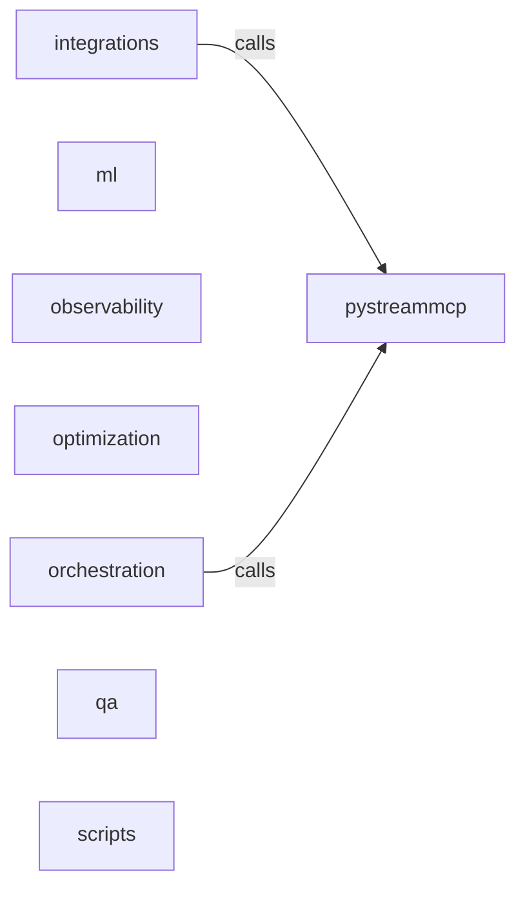

_Generated by CodeAtlas._

## Details

Owns 483 symbols across 26 file(s).

### integrations

Owns 121 symbols across 8 file(s).

**Related Classes/Methods:** _None_

**Source Files:**

- `python/pystreammcp/integrations/crewai.py`
  - `python.pystreammcp.integrations.crewai.CrewAIAdapter`
  - `python.pystreammcp.integrations.crewai.CrewAIAdapter.__init__`
  - `python.pystreammcp.integrations.crewai.CrewAIAdapter.discover`
  - `python.pystreammcp.integrations.crewai.CrewAIAdapter.discover_async`
  - `python.pystreammcp.integrations.crewai.CrewAIAdapter.optimize`
  - `python.pystreammcp.integrations.crewai.CrewAIAdapter.optimize_async`
  - `python.pystreammcp.integrations.crewai.CrewAIAdapter.query`
  - `python.pystreammcp.integrations.crewai.CrewAIAdapter.query_async`
  - `python.pystreammcp.integrations.crewai.PyStreamMCPTool`
  - `python.pystreammcp.integrations.crewai.PyStreamMCPTool.__call__`
  - `python.pystreammcp.integrations.crewai.PyStreamMCPTool.__init__`
  - `python.pystreammcp.integrations.crewai.PyStreamMCPTool.execute`
  - `python.pystreammcp.integrations.crewai.add_pystreammcp_to_agent`
  - `python.pystreammcp.integrations.crewai.create_pystreammcp_tool_for_crewai`
- `python/pystreammcp/integrations/haystack.py`
  - `python.pystreammcp.integrations.haystack.HaystackAdapter`
  - `python.pystreammcp.integrations.haystack.HaystackAdapter.__init__`
  - `python.pystreammcp.integrations.haystack.HaystackAdapter.discover`
  - `python.pystreammcp.integrations.haystack.HaystackAdapter.discover_async`
  - `python.pystreammcp.integrations.haystack.HaystackAdapter.optimize`
  - `python.pystreammcp.integrations.haystack.HaystackAdapter.optimize_async`
  - `python.pystreammcp.integrations.haystack.HaystackAdapter.query`
  - `python.pystreammcp.integrations.haystack.HaystackAdapter.query_async`
  - `python.pystreammcp.integrations.haystack.PyStreamMCPDocumentStore`
  - `python.pystreammcp.integrations.haystack.PyStreamMCPDocumentStore.__init__`
  - `python.pystreammcp.integrations.haystack.PyStreamMCPDocumentStore.query`
  - `python.pystreammcp.integrations.haystack.PyStreamMCPDocumentStore.retrieve_documents`
  - `python.pystreammcp.integrations.haystack.PyStreamMCPRetriever`
  - `python.pystreammcp.integrations.haystack.PyStreamMCPRetriever.__init__`
  - `python.pystreammcp.integrations.haystack.PyStreamMCPRetriever.from_dict`
  - `python.pystreammcp.integrations.haystack.PyStreamMCPRetriever.run`
  - `python.pystreammcp.integrations.haystack.PyStreamMCPRetriever.to_dict`
  - `python.pystreammcp.integrations.haystack.create_pystreammcp_retriever_for_haystack`
- `python/pystreammcp/integrations/langchain.py`
  - `python.pystreammcp.integrations.langchain.LangchainAdapter`
  - `python.pystreammcp.integrations.langchain.LangchainAdapter.__init__`
  - `python.pystreammcp.integrations.langchain.LangchainAdapter.discover`
  - `python.pystreammcp.integrations.langchain.LangchainAdapter.discover_async`
  - `python.pystreammcp.integrations.langchain.LangchainAdapter.get_retriever_for_langchain`
  - `python.pystreammcp.integrations.langchain.LangchainAdapter.get_retriever_for_langchain.PyStreamMCPLangchainRetriever`
  - `python.pystreammcp.integrations.langchain.LangchainAdapter.get_retriever_for_langchain.PyStreamMCPLangchainRetriever._get_relevant_documents`
  - `python.pystreammcp.integrations.langchain.LangchainAdapter.get_tool_for_langchain`
  - `python.pystreammcp.integrations.langchain.LangchainAdapter.get_tool_for_langchain.execute_query`
  - `python.pystreammcp.integrations.langchain.LangchainAdapter.optimize`
  - `python.pystreammcp.integrations.langchain.LangchainAdapter.optimize_async`
  - `python.pystreammcp.integrations.langchain.LangchainAdapter.query`
  - `python.pystreammcp.integrations.langchain.LangchainAdapter.query_async`
  - `python.pystreammcp.integrations.langchain.PyStreamMCPRetriever`
  - `python.pystreammcp.integrations.langchain.PyStreamMCPRetriever.__init__`
  - `python.pystreammcp.integrations.langchain.PyStreamMCPRetriever.get_relevant_documents`
  - `python.pystreammcp.integrations.langchain.PyStreamMCPRetriever.get_retriever_for_langchain`
  - `python.pystreammcp.integrations.langchain.PyStreamMCPTool`
  - `python.pystreammcp.integrations.langchain.PyStreamMCPTool.__call__`
  - `python.pystreammcp.integrations.langchain.PyStreamMCPTool.__init__`
  - `python.pystreammcp.integrations.langchain.PyStreamMCPTool.get_metrics`
  - `python.pystreammcp.integrations.langchain.PyStreamMCPTool.get_tool_for_langchain`
  - `python.pystreammcp.integrations.langchain.create_pystreammcp_agent`
- `python/pystreammcp/integrations/langsmith.py`
  - `python.pystreammcp.integrations.langsmith.CostAnalytics`
  - `python.pystreammcp.integrations.langsmith.LangSmithSpan`
  - `python.pystreammcp.integrations.langsmith.LangSmithTracer`
  - `python.pystreammcp.integrations.langsmith.LangSmithTracer.__init__`
  - `python.pystreammcp.integrations.langsmith.LangSmithTracer._calculate_percentile`
  - `python.pystreammcp.integrations.langsmith.LangSmithTracer.end_span`
  - `python.pystreammcp.integrations.langsmith.LangSmithTracer.export_to_langsmith`
  - `python.pystreammcp.integrations.langsmith.LangSmithTracer.get_cost_analytics`
  - `python.pystreammcp.integrations.langsmith.LangSmithTracer.get_dashboard_data`
  - `python.pystreammcp.integrations.langsmith.LangSmithTracer.start_span`
  - `python.pystreammcp.integrations.langsmith.LangSmithTracer.start_trace`
  - `python.pystreammcp.integrations.langsmith.LangSmithTracer.trace_query`
  - `python.pystreammcp.integrations.langsmith.SpanType`
- `python/pystreammcp/integrations/llamaindex.py`
  - `python.pystreammcp.integrations.llamaindex.LlamaIndexAdapter`
  - `python.pystreammcp.integrations.llamaindex.LlamaIndexAdapter.__init__`
  - `python.pystreammcp.integrations.llamaindex.LlamaIndexAdapter.discover`
  - `python.pystreammcp.integrations.llamaindex.LlamaIndexAdapter.discover_async`
  - `python.pystreammcp.integrations.llamaindex.LlamaIndexAdapter.get_retriever_for_llamaindex`
  - `python.pystreammcp.integrations.llamaindex.LlamaIndexAdapter.get_retriever_for_llamaindex.PyStreamMCPRetriever`
  - `python.pystreammcp.integrations.llamaindex.LlamaIndexAdapter.get_retriever_for_llamaindex.PyStreamMCPRetriever._retrieve`
  - `python.pystreammcp.integrations.llamaindex.LlamaIndexAdapter.optimize`
  - `python.pystreammcp.integrations.llamaindex.LlamaIndexAdapter.optimize_async`
  - `python.pystreammcp.integrations.llamaindex.LlamaIndexAdapter.query`
  - `python.pystreammcp.integrations.llamaindex.LlamaIndexAdapter.query_async`
  - `python.pystreammcp.integrations.llamaindex.StreamMCPQueryEngine`
  - `python.pystreammcp.integrations.llamaindex.StreamMCPQueryEngine.__init__`
  - `python.pystreammcp.integrations.llamaindex.StreamMCPQueryEngine.query`
  - `python.pystreammcp.integrations.llamaindex.StreamMCPRetriever`
  - `python.pystreammcp.integrations.llamaindex.StreamMCPRetriever.__init__`
  - `python.pystreammcp.integrations.llamaindex.StreamMCPRetriever.get_retriever_for_llamaindex`
  - `python.pystreammcp.integrations.llamaindex.StreamMCPRetriever.retrieve`
  - `python.pystreammcp.integrations.llamaindex.StreamMCPRetriever.retrieve.NodeWithScore`
  - `python.pystreammcp.integrations.llamaindex.StreamMCPRetriever.retrieve.NodeWithScore.__init__`
  - `python.pystreammcp.integrations.llamaindex.StreamMCPRetriever.retrieve.TextNode`
  - `python.pystreammcp.integrations.llamaindex.StreamMCPRetriever.retrieve.TextNode.__init__`
  - `python.pystreammcp.integrations.llamaindex.create_pystreammcp_index`
- `python/pystreammcp/integrations/pydantic_ai.py`
  - `python.pystreammcp.integrations.pydantic_ai.PyStreamMCPRetriever`
  - `python.pystreammcp.integrations.pydantic_ai.PyStreamMCPRetriever.__init__`
  - `python.pystreammcp.integrations.pydantic_ai.PyStreamMCPRetriever.batch_retrieve`
  - `python.pystreammcp.integrations.pydantic_ai.PyStreamMCPRetriever.retrieve`
  - `python.pystreammcp.integrations.pydantic_ai.PydanticAIAdapter`
  - `python.pystreammcp.integrations.pydantic_ai.PydanticAIAdapter.__init__`
  - `python.pystreammcp.integrations.pydantic_ai.PydanticAIAdapter.discover`
  - `python.pystreammcp.integrations.pydantic_ai.PydanticAIAdapter.discover_async`
  - `python.pystreammcp.integrations.pydantic_ai.PydanticAIAdapter.optimize`
  - `python.pystreammcp.integrations.pydantic_ai.PydanticAIAdapter.optimize_async`
  - `python.pystreammcp.integrations.pydantic_ai.PydanticAIAdapter.query`
  - `python.pystreammcp.integrations.pydantic_ai.PydanticAIAdapter.query_async`
  - `python.pystreammcp.integrations.pydantic_ai.create_pystreammcp_retriever_for_pydantic`
- `python/pystreammcp/integrations/semantic_kernel.py`
  - `python.pystreammcp.integrations.semantic_kernel.PyStreamMCPPlugin`
  - `python.pystreammcp.integrations.semantic_kernel.PyStreamMCPPlugin.__init__`
  - `python.pystreammcp.integrations.semantic_kernel.PyStreamMCPPlugin.discover_sources`
  - `python.pystreammcp.integrations.semantic_kernel.PyStreamMCPPlugin.get_metrics`
  - `python.pystreammcp.integrations.semantic_kernel.PyStreamMCPPlugin.optimize_query`
  - `python.pystreammcp.integrations.semantic_kernel.SemanticKernelAdapter`
  - `python.pystreammcp.integrations.semantic_kernel.SemanticKernelAdapter.__init__`
  - `python.pystreammcp.integrations.semantic_kernel.SemanticKernelAdapter.discover`
  - `python.pystreammcp.integrations.semantic_kernel.SemanticKernelAdapter.discover_async`
  - `python.pystreammcp.integrations.semantic_kernel.SemanticKernelAdapter.get_native_plugin`
  - `python.pystreammcp.integrations.semantic_kernel.SemanticKernelAdapter.get_native_plugin.PyStreamMCPSkPlugin`
  - `python.pystreammcp.integrations.semantic_kernel.SemanticKernelAdapter.get_native_plugin.PyStreamMCPSkPlugin.discover_context`
  - `python.pystreammcp.integrations.semantic_kernel.SemanticKernelAdapter.get_native_plugin.PyStreamMCPSkPlugin.optimize_query`
  - `python.pystreammcp.integrations.semantic_kernel.SemanticKernelAdapter.optimize`
  - `python.pystreammcp.integrations.semantic_kernel.SemanticKernelAdapter.optimize_async`
  - `python.pystreammcp.integrations.semantic_kernel.SemanticKernelAdapter.query`
  - `python.pystreammcp.integrations.semantic_kernel.SemanticKernelAdapter.query_async`

### ml

Owns 34 symbols across 3 file(s).

**Related Classes/Methods:** _None_

**Source Files:**

- `python/pystreammcp/ml/relevance.py`
  - `python.pystreammcp.ml.relevance.ModelTrainer`
  - `python.pystreammcp.ml.relevance.ModelTrainer.__init__`
  - `python.pystreammcp.ml.relevance.ModelTrainer.get_training_history`
  - `python.pystreammcp.ml.relevance.ModelTrainer.load_production_data`
  - `python.pystreammcp.ml.relevance.ModelTrainer.train_and_validate`
  - `python.pystreammcp.ml.relevance.QueryFeatures`
  - `python.pystreammcp.ml.relevance.QueryFeatures.to_vector`
  - `python.pystreammcp.ml.relevance.QueryResult`
  - `python.pystreammcp.ml.relevance.RelevanceModel`
  - `python.pystreammcp.ml.relevance.RelevanceModel.__init__`
  - `python.pystreammcp.ml.relevance.RelevanceModel._learn_source_weights`
  - `python.pystreammcp.ml.relevance.RelevanceModel.add_training_sample`
  - `python.pystreammcp.ml.relevance.RelevanceModel.export_model`
  - `python.pystreammcp.ml.relevance.RelevanceModel.import_model`
  - `python.pystreammcp.ml.relevance.RelevanceModel.predict_relevance`
  - `python.pystreammcp.ml.relevance.RelevanceModel.rank_sources`
  - `python.pystreammcp.ml.relevance.RelevanceModel.train`
- `python/pystreammcp/ml/tagging.py`
  - `python.pystreammcp.ml.tagging.PromptAnalysis`
  - `python.pystreammcp.ml.tagging.PromptClassifier`
  - `python.pystreammcp.ml.tagging.PromptClassifier.__init__`
  - `python.pystreammcp.ml.tagging.PromptClassifier._calculate_quality_score`
  - `python.pystreammcp.ml.tagging.PromptClassifier._detect_complexity`
  - `python.pystreammcp.ml.tagging.PromptClassifier._detect_dependencies`
  - `python.pystreammcp.ml.tagging.PromptClassifier._detect_domain`
  - `python.pystreammcp.ml.tagging.PromptClassifier._detect_intent`
  - `python.pystreammcp.ml.tagging.PromptClassifier._generate_tags`
  - `python.pystreammcp.ml.tagging.PromptClassifier.add_training_sample`
  - `python.pystreammcp.ml.tagging.PromptClassifier.analyze`
  - `python.pystreammcp.ml.tagging.PromptClassifier.batch_analyze`
  - `python.pystreammcp.ml.tagging.PromptClassifier.get_routing_strategy`
  - `python.pystreammcp.ml.tagging.PromptClassifier.train`
  - `python.pystreammcp.ml.tagging.PromptComplexity`
  - `python.pystreammcp.ml.tagging.PromptIntent`
  - `python.pystreammcp.ml.tagging.PromptTag`

### observability

Owns 12 symbols across 2 file(s).

**Related Classes/Methods:** _None_

**Source Files:**

- `python/pystreammcp/observability/metrics.py`
  - `python.pystreammcp.observability.metrics.Metric`
  - `python.pystreammcp.observability.metrics.MetricPoint`
  - `python.pystreammcp.observability.metrics.MetricsCollector`
  - `python.pystreammcp.observability.metrics.MetricsCollector.__init__`
  - `python.pystreammcp.observability.metrics.MetricsCollector._initialize_metrics`
  - `python.pystreammcp.observability.metrics.MetricsCollector.export_prometheus`
  - `python.pystreammcp.observability.metrics.MetricsCollector.flush_buffer`
  - `python.pystreammcp.observability.metrics.MetricsCollector.get_metrics`
  - `python.pystreammcp.observability.metrics.MetricsCollector.get_summary`
  - `python.pystreammcp.observability.metrics.MetricsCollector.record_error`
  - `python.pystreammcp.observability.metrics.MetricsCollector.record_model_accuracy`
  - `python.pystreammcp.observability.metrics.MetricsCollector.record_query`

### optimization

Owns 31 symbols across 4 file(s).

**Related Classes/Methods:** _None_

**Source Files:**

- `python/pystreammcp/optimization/advanced.py`
  - `python.pystreammcp.optimization.advanced.CostOptimizationEngine`
  - `python.pystreammcp.optimization.advanced.CostOptimizationEngine.__init__`
  - `python.pystreammcp.optimization.advanced.CostOptimizationEngine.estimate_speedup`
  - `python.pystreammcp.optimization.advanced.CostOptimizationEngine.optimize_multi_agent_query`
  - `python.pystreammcp.optimization.advanced.MultiAgentContextSharing`
  - `python.pystreammcp.optimization.advanced.MultiAgentContextSharing.__init__`
  - `python.pystreammcp.optimization.advanced.MultiAgentContextSharing.cleanup_expired`
  - `python.pystreammcp.optimization.advanced.MultiAgentContextSharing.create_shared_context`
  - `python.pystreammcp.optimization.advanced.MultiAgentContextSharing.get_context_reuse_stats`
  - `python.pystreammcp.optimization.advanced.MultiAgentContextSharing.request_context`
  - `python.pystreammcp.optimization.advanced.SharedContext`
  - `python.pystreammcp.optimization.advanced.StreamingContext`
  - `python.pystreammcp.optimization.advanced.StreamingContextWindow`
  - `python.pystreammcp.optimization.advanced.StreamingContextWindow.__init__`
  - `python.pystreammcp.optimization.advanced.StreamingContextWindow.close_stream`
  - `python.pystreammcp.optimization.advanced.StreamingContextWindow.create_stream`
  - `python.pystreammcp.optimization.advanced.StreamingContextWindow.get_stream_stats`
  - `python.pystreammcp.optimization.advanced.StreamingContextWindow.stream_chunk`
- `python/pystreammcp/optimization/decomposition.py`
  - `python.pystreammcp.optimization.decomposition.DecompositionPlan`
  - `python.pystreammcp.optimization.decomposition.QueryDecomposer`
  - `python.pystreammcp.optimization.decomposition.QueryDecomposer.__init__`
  - `python.pystreammcp.optimization.decomposition.QueryDecomposer._decompose_aggregated`
  - `python.pystreammcp.optimization.decomposition.QueryDecomposer._decompose_complex`
  - `python.pystreammcp.optimization.decomposition.QueryDecomposer._decompose_joined`
  - `python.pystreammcp.optimization.decomposition.QueryDecomposer._decompose_simple`
  - `python.pystreammcp.optimization.decomposition.QueryDecomposer.analyze_query`
  - `python.pystreammcp.optimization.decomposition.QueryDecomposer.decompose`
  - `python.pystreammcp.optimization.decomposition.QueryDecomposer.estimate_speedup`
  - `python.pystreammcp.optimization.decomposition.QueryDecomposer.get_execution_order`
  - `python.pystreammcp.optimization.decomposition.QueryType`
  - `python.pystreammcp.optimization.decomposition.SubQuery`

### orchestration

Owns 45 symbols across 4 file(s).

**Related Classes/Methods:** _None_

**Source Files:**

- `python/pystreammcp/orchestration/airflow.py`
  - `python.pystreammcp.orchestration.airflow.AirflowOperatorConfig`
  - `python.pystreammcp.orchestration.airflow.PyStreamMCPDAGFactory`
  - `python.pystreammcp.orchestration.airflow.PyStreamMCPDAGFactory.__init__`
  - `python.pystreammcp.orchestration.airflow.PyStreamMCPDAGFactory.create_discovery_dag`
  - `python.pystreammcp.orchestration.airflow.PyStreamMCPDAGFactory.create_pipeline_dag`
  - `python.pystreammcp.orchestration.airflow.PyStreamMCPDAGFactory.create_query_dag`
  - `python.pystreammcp.orchestration.airflow.PyStreamMCPDiscoveryOperator`
  - `python.pystreammcp.orchestration.airflow.PyStreamMCPDiscoveryOperator.__init__`
  - `python.pystreammcp.orchestration.airflow.PyStreamMCPDiscoveryOperator.execute`
  - `python.pystreammcp.orchestration.airflow.PyStreamMCPOptimizeOperator`
  - `python.pystreammcp.orchestration.airflow.PyStreamMCPOptimizeOperator.__init__`
  - `python.pystreammcp.orchestration.airflow.PyStreamMCPOptimizeOperator.execute`
  - `python.pystreammcp.orchestration.airflow.PyStreamMCPQueryOperator`
  - `python.pystreammcp.orchestration.airflow.PyStreamMCPQueryOperator.__init__`
  - `python.pystreammcp.orchestration.airflow.PyStreamMCPQueryOperator.execute`
- `python/pystreammcp/orchestration/nocode_rpa.py`
  - `python.pystreammcp.orchestration.nocode_rpa.N8nWebhookTrigger`
  - `python.pystreammcp.orchestration.nocode_rpa.N8nWebhookTrigger.__init__`
  - `python.pystreammcp.orchestration.nocode_rpa.N8nWebhookTrigger.get_webhook_spec`
  - `python.pystreammcp.orchestration.nocode_rpa.N8nWebhookTrigger.handle_discovery`
  - `python.pystreammcp.orchestration.nocode_rpa.N8nWebhookTrigger.handle_query`
  - `python.pystreammcp.orchestration.nocode_rpa.PowerAutomateConnector`
  - `python.pystreammcp.orchestration.nocode_rpa.PowerAutomateConnector.__init__`
  - `python.pystreammcp.orchestration.nocode_rpa.PowerAutomateConnector.get_custom_connector_spec`
  - `python.pystreammcp.orchestration.nocode_rpa.PowerAutomateConnector.query`
  - `python.pystreammcp.orchestration.nocode_rpa.RoboticProcessAdapter`
  - `python.pystreammcp.orchestration.nocode_rpa.RoboticProcessAdapter.__init__`
  - `python.pystreammcp.orchestration.nocode_rpa.RoboticProcessAdapter.execute_batch_activity`
  - `python.pystreammcp.orchestration.nocode_rpa.RoboticProcessAdapter.execute_query_activity`
  - `python.pystreammcp.orchestration.nocode_rpa.RoboticProcessAdapter.get_automation_anywhere_spec`
  - `python.pystreammcp.orchestration.nocode_rpa.RoboticProcessAdapter.get_uipath_activity_spec`
- `python/pystreammcp/orchestration/temporal.py`
  - `python.pystreammcp.orchestration.temporal.TemporalClient`
  - `python.pystreammcp.orchestration.temporal.TemporalClient.__init__`
  - `python.pystreammcp.orchestration.temporal.TemporalClient.get_workflow_status`
  - `python.pystreammcp.orchestration.temporal.TemporalClient.list_workflows`
  - `python.pystreammcp.orchestration.temporal.TemporalClient.start_workflow`
  - `python.pystreammcp.orchestration.temporal.TemporalDiscoveryActivity`
  - `python.pystreammcp.orchestration.temporal.TemporalDiscoveryActivity.execute`
  - `python.pystreammcp.orchestration.temporal.TemporalQueryActivity`
  - `python.pystreammcp.orchestration.temporal.TemporalQueryActivity.execute`
  - `python.pystreammcp.orchestration.temporal.TemporalWorkflow`
  - `python.pystreammcp.orchestration.temporal.TemporalWorkflow.__init__`
  - `python.pystreammcp.orchestration.temporal.TemporalWorkflow.discover_sources`
  - `python.pystreammcp.orchestration.temporal.TemporalWorkflow.execute_parallel_queries`
  - `python.pystreammcp.orchestration.temporal.TemporalWorkflow.optimize_query`
  - `python.pystreammcp.orchestration.temporal.TemporalWorkflow.workflow_definition`

### qa

Owns 19 symbols across 2 file(s).

**Related Classes/Methods:** _None_

**Source Files:**

- `python/pystreammcp/qa/validator.py`
  - `python.pystreammcp.qa.validator.AuditEntry`
  - `python.pystreammcp.qa.validator.AuditLogger`
  - `python.pystreammcp.qa.validator.AuditLogger.__init__`
  - `python.pystreammcp.qa.validator.AuditLogger.get_audit_trail`
  - `python.pystreammcp.qa.validator.AuditLogger.get_compliance_report`
  - `python.pystreammcp.qa.validator.AuditLogger.log_operation`
  - `python.pystreammcp.qa.validator.QualityValidator`
  - `python.pystreammcp.qa.validator.QualityValidator.__init__`
  - `python.pystreammcp.qa.validator.QualityValidator._check_rule`
  - `python.pystreammcp.qa.validator.QualityValidator._setup_default_rules`
  - `python.pystreammcp.qa.validator.QualityValidator.add_rule`
  - `python.pystreammcp.qa.validator.QualityValidator.get_validation_summary`
  - `python.pystreammcp.qa.validator.QualityValidator.validate`
  - `python.pystreammcp.qa.validator.SLAChecker`
  - `python.pystreammcp.qa.validator.SLAChecker.__init__`
  - `python.pystreammcp.qa.validator.SLAChecker.check_sla`
  - `python.pystreammcp.qa.validator.ValidationResult`
  - `python.pystreammcp.qa.validator.ValidationRule`
  - `python.pystreammcp.qa.validator.ValidationStatus`

### scripts

Owns 1 symbols across 2 file(s).

**Related Classes/Methods:** _None_

**Source Files:**

- `python/pystreammcp/scripts/post_install.py`
  - `python.pystreammcp.scripts.post_install.post_install`
