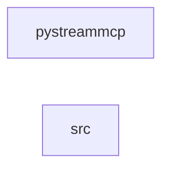

_Generated by CodeAtlas._

## Details

Owns 0 symbols across 1 file(s).

### pystreammcp

Owns 483 symbols across 26 file(s).

**Related Classes/Methods:** _None_

**Source Files:**

- `python/pystreammcp/_mcp_connector.py`
  - `python.pystreammcp._mcp_connector.BaseMCPConnector`
  - `python.pystreammcp._mcp_connector.BaseMCPConnector.__init__`
  - `python.pystreammcp._mcp_connector.BaseMCPConnector._generate_dab_config`
  - `python.pystreammcp._mcp_connector.BaseMCPConnector._start_dab_subprocess`
  - `python.pystreammcp._mcp_connector.BaseMCPConnector._write_temp_config`
  - `python.pystreammcp._mcp_connector.BaseMCPConnector.get_mcp_tools`
  - `python.pystreammcp._mcp_connector.BaseMCPConnector.get_tool_handlers`
  - `python.pystreammcp._mcp_connector.BaseMCPConnector.is_ready`
  - `python.pystreammcp._mcp_connector.BaseMCPConnector.start_mcp_connector`
  - `python.pystreammcp._mcp_connector.BaseMCPConnector.stop_mcp_connector`
  - `python.pystreammcp._mcp_connector.DiscoveredProject`
  - `python.pystreammcp._mcp_connector.Orchestrator`
  - `python.pystreammcp._mcp_connector.Orchestrator.__init__`
  - `python.pystreammcp._mcp_connector.Orchestrator._estimate_tokens`
  - `python.pystreammcp._mcp_connector.Orchestrator._load_federation_endpoints`
  - `python.pystreammcp._mcp_connector.Orchestrator._probe_endpoint`
  - `python.pystreammcp._mcp_connector.Orchestrator._project_name_from_endpoint`
  - `python.pystreammcp._mcp_connector.Orchestrator._relevance_score`
  - `python.pystreammcp._mcp_connector.Orchestrator._tokenize`
  - `python.pystreammcp._mcp_connector.Orchestrator.cache_management`
  - `python.pystreammcp._mcp_connector.Orchestrator.detect_compatible_projects`
  - `python.pystreammcp._mcp_connector.Orchestrator.discover_mcp_projects`
  - `python.pystreammcp._mcp_connector.Orchestrator.error_recovery_retry`
  - `python.pystreammcp._mcp_connector.Orchestrator.estimate_query_cost_multi_project`
  - `python.pystreammcp._mcp_connector.Orchestrator.execute_federated_query`
  - `python.pystreammcp._mcp_connector.Orchestrator.get_tool_routing_info`
  - `python.pystreammcp._mcp_connector.Orchestrator.handle_cross_database_join`
  - `python.pystreammcp._mcp_connector.Orchestrator.list_service_endpoints`
  - `python.pystreammcp._mcp_connector.Orchestrator.manage_endpoint_federation`
  - `python.pystreammcp._mcp_connector.Orchestrator.monitor_mcp_health`
  - `python.pystreammcp._mcp_connector.Orchestrator.optimize_cross_project_query`
  - `python.pystreammcp._mcp_connector.Orchestrator.orchestrate_cross_mcp_workflow`
  - `python.pystreammcp._mcp_connector.Orchestrator.plan_query_execution`
  - `python.pystreammcp._mcp_connector.Orchestrator.rank_tools_by_relevance`
  - `python.pystreammcp._mcp_connector.Orchestrator.register_orchestration_webhook`
  - `python.pystreammcp._mcp_connector.Orchestrator.report_performance_metrics`
  - `python.pystreammcp._mcp_connector.Orchestrator.route_tool_invocation`
  - `python.pystreammcp._mcp_connector.Orchestrator.start_mcp_connector`
  - `python.pystreammcp._mcp_connector.Orchestrator.stop_mcp_connector`
  - `python.pystreammcp._mcp_connector._MCPOrchestratorConnector`
  - `python.pystreammcp._mcp_connector._MCPOrchestratorConnector.__init__`
  - `python.pystreammcp._mcp_connector._MCPOrchestratorConnector.get_mcp_tools`
  - `python.pystreammcp._mcp_connector._MCPOrchestratorConnector.get_tool_handlers`
  - `python.pystreammcp._mcp_connector._read_toml`
- `python/pystreammcp/_mcp_tools.py`
  - `python.pystreammcp._mcp_tools.PyStreamMCPHandler`
  - `python.pystreammcp._mcp_tools.PyStreamMCPHandler.__init__`
  - `python.pystreammcp._mcp_tools.PyStreamMCPHandler.cache_management`
  - `python.pystreammcp._mcp_tools.PyStreamMCPHandler.detect_compatible_projects`
  - `python.pystreammcp._mcp_tools.PyStreamMCPHandler.discover_mcp_projects`
  - `python.pystreammcp._mcp_tools.PyStreamMCPHandler.error_recovery_retry`
  - `python.pystreammcp._mcp_tools.PyStreamMCPHandler.estimate_query_cost_multi_project`
  - `python.pystreammcp._mcp_tools.PyStreamMCPHandler.execute_federated_query`
  - `python.pystreammcp._mcp_tools.PyStreamMCPHandler.get_tool_routing_info`
  - `python.pystreammcp._mcp_tools.PyStreamMCPHandler.handle_cross_database_join`
  - `python.pystreammcp._mcp_tools.PyStreamMCPHandler.list_service_endpoints`
  - `python.pystreammcp._mcp_tools.PyStreamMCPHandler.manage_endpoint_federation`
  - `python.pystreammcp._mcp_tools.PyStreamMCPHandler.monitor_mcp_health`
  - `python.pystreammcp._mcp_tools.PyStreamMCPHandler.optimize_cross_project_query`
  - `python.pystreammcp._mcp_tools.PyStreamMCPHandler.orchestrate_cross_mcp_workflow`
  - `python.pystreammcp._mcp_tools.PyStreamMCPHandler.plan_query_execution`
  - `python.pystreammcp._mcp_tools.PyStreamMCPHandler.rank_tools_by_relevance`
  - `python.pystreammcp._mcp_tools.PyStreamMCPHandler.register_orchestration_webhook`
  - `python.pystreammcp._mcp_tools.PyStreamMCPHandler.report_performance_metrics`
  - `python.pystreammcp._mcp_tools.PyStreamMCPHandler.route_tool_invocation`
  - `python.pystreammcp._mcp_tools.PyStreamMCPTools`
  - `python.pystreammcp._mcp_tools.PyStreamMCPTools.get_tools`
- `python/pystreammcp/adapters.py`
  - `python.pystreammcp.adapters.AdapterConfig`
  - `python.pystreammcp.adapters.AdapterRegistry`
  - `python.pystreammcp.adapters.AdapterRegistry.create_adapter`
  - `python.pystreammcp.adapters.AdapterRegistry.get_adapter`
  - `python.pystreammcp.adapters.AdapterRegistry.get_adapter_class`
  - `python.pystreammcp.adapters.AdapterRegistry.list_adapters`
  - `python.pystreammcp.adapters.AdapterRegistry.list_supported_frameworks`
  - `python.pystreammcp.adapters.AdapterRegistry.register`
  - `python.pystreammcp.adapters.AgentFrameworkAdapter`
  - `python.pystreammcp.adapters.AgentFrameworkAdapter.__init__`
  - `python.pystreammcp.adapters.AgentFrameworkAdapter.discover`
  - `python.pystreammcp.adapters.AgentFrameworkAdapter.discover_async`
  - `python.pystreammcp.adapters.AgentFrameworkAdapter.get_tools`
  - `python.pystreammcp.adapters.AgentFrameworkAdapter.is_async_capable`
  - `python.pystreammcp.adapters.AgentFrameworkAdapter.optimize`
  - `python.pystreammcp.adapters.AgentFrameworkAdapter.optimize_async`
  - `python.pystreammcp.adapters.AgentFrameworkAdapter.query`
  - `python.pystreammcp.adapters.AgentFrameworkAdapter.query_async`
  - `python.pystreammcp.adapters.FrameworkType`
  - `python.pystreammcp.adapters.QueryResult`
- `python/pystreammcp/agent.py`
  - `python.pystreammcp.agent.Agent`
  - `python.pystreammcp.agent.Agent.__init__`
  - `python.pystreammcp.agent.Agent.agent_id`
  - `python.pystreammcp.agent.Agent.get_metrics`
  - `python.pystreammcp.agent.Agent.max_tokens`
  - `python.pystreammcp.agent.Agent.name`
  - `python.pystreammcp.agent.Agent.optimization_strategy`
  - `python.pystreammcp.agent.Agent.query`
  - `python.pystreammcp.agent.AgentConfig`
  - `python.pystreammcp.agent.QueryResult`
  - `python.pystreammcp.agent.QueryResult.__post_init__`
  - `python.pystreammcp.agent.QueryResult.exceeds_target`
  - `python.pystreammcp.agent.QueryResult.get_context_text`
  - `python.pystreammcp.agent.QueryResult.is_effective`
- `python/pystreammcp/api.py`
  - `python.pystreammcp.api.AgentConfig`
  - `python.pystreammcp.api.AgentResponse`
  - `python.pystreammcp.api.DiscoveryRequest`
  - `python.pystreammcp.api.DiscoveryResponse`
  - `python.pystreammcp.api.HealthResponse`
  - `python.pystreammcp.api.OptimizationRequest`
  - `python.pystreammcp.api.OptimizationResponse`
  - `python.pystreammcp.api.PyStreamMCPAPI`
  - `python.pystreammcp.api.PyStreamMCPAPI.__init__`
  - `python.pystreammcp.api.PyStreamMCPAPI._create_app`
  - `python.pystreammcp.api.PyStreamMCPAPI._create_app.batch_query`
  - `python.pystreammcp.api.PyStreamMCPAPI._create_app.create_agent`
  - `python.pystreammcp.api.PyStreamMCPAPI._create_app.discover`
  - `python.pystreammcp.api.PyStreamMCPAPI._create_app.get_agent`
  - `python.pystreammcp.api.PyStreamMCPAPI._create_app.health`
  - `python.pystreammcp.api.PyStreamMCPAPI._create_app.info`
  - `python.pystreammcp.api.PyStreamMCPAPI._create_app.lifespan`
  - `python.pystreammcp.api.PyStreamMCPAPI._create_app.list_agents`
  - `python.pystreammcp.api.PyStreamMCPAPI._create_app.list_sources`
  - `python.pystreammcp.api.PyStreamMCPAPI._create_app.metrics`
  - `python.pystreammcp.api.PyStreamMCPAPI._create_app.optimize`
  - `python.pystreammcp.api.PyStreamMCPAPI._create_app.query`
  - `python.pystreammcp.api.PyStreamMCPAPI._create_app.register_source`
  - `python.pystreammcp.api.PyStreamMCPAPI._create_app.unregister_source`
  - `python.pystreammcp.api.PyStreamMCPAPI._get_agent`
  - `python.pystreammcp.api.PyStreamMCPAPI.run`
  - `python.pystreammcp.api.QueryRequest`
  - `python.pystreammcp.api.QueryResponse`
  - `python.pystreammcp.api.SourceRegistration`
  - `python.pystreammcp.api.create_app`
- `python/pystreammcp/cli.py`
  - `python.pystreammcp.cli.cli`
  - `python.pystreammcp.cli.dashboard`
  - `python.pystreammcp.cli.query`
  - `python.pystreammcp.cli.server`
  - `python.pystreammcp.cli.version`
- `python/pystreammcp/cli_daemon.py`
  - `python.pystreammcp.cli_daemon.DashboardDaemon`
  - `python.pystreammcp.cli_daemon.DashboardDaemon.__init__`
  - `python.pystreammcp.cli_daemon.DashboardDaemon._handle_interrupt`
  - `python.pystreammcp.cli_daemon.DashboardDaemon.start`
  - `python.pystreammcp.cli_daemon.start_persistent_dashboard`
- `python/pystreammcp/cli_dashboard.py`
  - `python.pystreammcp.cli_dashboard.DashboardMetrics`
  - `python.pystreammcp.cli_dashboard.PyStreamMCPDashboard`
  - `python.pystreammcp.cli_dashboard.PyStreamMCPDashboard.__init__`
  - `python.pystreammcp.cli_dashboard.PyStreamMCPDashboard.export_json`
  - `python.pystreammcp.cli_dashboard.PyStreamMCPDashboard.get_mock_metrics`
  - `python.pystreammcp.cli_dashboard.PyStreamMCPDashboard.run_dashboard`
  - `python.pystreammcp.cli_dashboard.PyStreamMCPDashboard.show_alerts`
  - `python.pystreammcp.cli_dashboard.PyStreamMCPDashboard.show_recommendations`
  - `python.pystreammcp.cli_dashboard.RichDashboard`
  - `python.pystreammcp.cli_dashboard.RichDashboard.__init__`
  - `python.pystreammcp.cli_dashboard.RichDashboard.render`
  - `python.pystreammcp.cli_dashboard.RichDashboard.run`
  - `python.pystreammcp.cli_dashboard.SimpleDashboard`
  - `python.pystreammcp.cli_dashboard.SimpleDashboard.__init__`
  - `python.pystreammcp.cli_dashboard.SimpleDashboard.render`
  - `python.pystreammcp.cli_dashboard.SimpleDashboard.run`
  - `python.pystreammcp.cli_dashboard.TextualDashboard`
  - `python.pystreammcp.cli_dashboard.TextualDashboard.__init__`
  - `python.pystreammcp.cli_dashboard.TextualDashboard.render`
  - `python.pystreammcp.cli_dashboard.TextualDashboard.run`
  - `python.pystreammcp.cli_dashboard.get_dashboard_impl`
- `python/pystreammcp/context.py`
  - `python.pystreammcp.context.Context`
  - `python.pystreammcp.context.Context.__post_init__`
  - `python.pystreammcp.context.Context.with_relevance`
  - `python.pystreammcp.context.ContextType`
  - `python.pystreammcp.context.ContextWindow`
  - `python.pystreammcp.context.ContextWindow.add_context`
  - `python.pystreammcp.context.ContextWindow.is_full`
  - `python.pystreammcp.context.ContextWindow.remaining_tokens`
  - `python.pystreammcp.context.ContextWindow.utilization_percent`
- `python/pystreammcp/decomposition.py`
  - `python.pystreammcp.decomposition.DecomposedQuery`
  - `python.pystreammcp.decomposition.DecomposedQuery.can_parallelize`
  - `python.pystreammcp.decomposition.DecomposedQuery.is_complex`
  - `python.pystreammcp.decomposition.DecomposedQuery.step_count`
  - `python.pystreammcp.decomposition.ExecutionPlan`
  - `python.pystreammcp.decomposition.ExecutionPlan.is_parallelizable`
  - `python.pystreammcp.decomposition.ExecutionPlan.stage_count`
  - `python.pystreammcp.decomposition.QueryDecomposer`
  - `python.pystreammcp.decomposition.QueryDecomposer._calculate_complexity`
  - `python.pystreammcp.decomposition.QueryDecomposer._choose_strategy`
  - `python.pystreammcp.decomposition.QueryDecomposer._estimate_tokens`
  - `python.pystreammcp.decomposition.QueryDecomposer._extract_sources`
  - `python.pystreammcp.decomposition.QueryDecomposer._split_query`
  - `python.pystreammcp.decomposition.QueryDecomposer.decompose`
  - `python.pystreammcp.decomposition.QueryDecomposer.optimize_execution_plan`
  - `python.pystreammcp.decomposition.QueryStep`
- `python/pystreammcp/discovery.py`
  - `python.pystreammcp.discovery.DataSource`
  - `python.pystreammcp.discovery.DataSource._text`
  - `python.pystreammcp.discovery.DiscoveredSource`
  - `python.pystreammcp.discovery.DiscoveredSource.__post_init__`
  - `python.pystreammcp.discovery.DiscoveredSource.quality_score`
  - `python.pystreammcp.discovery.DiscoveredSource.with_freshness`
  - `python.pystreammcp.discovery.Discovery`
  - `python.pystreammcp.discovery.Discovery.__post_init__`
  - `python.pystreammcp.discovery.Discovery.add_source`
  - `python.pystreammcp.discovery.Discovery.high_relevance_sources`
  - `python.pystreammcp.discovery.Discovery.top_sources`
  - `python.pystreammcp.discovery.Discovery.total_available_tokens`
  - `python.pystreammcp.discovery.SourceRegistry`
  - `python.pystreammcp.discovery.SourceRegistry.__init__`
  - `python.pystreammcp.discovery.SourceRegistry._score`
  - `python.pystreammcp.discovery.SourceRegistry.discover`
  - `python.pystreammcp.discovery.SourceRegistry.discover_typed`
  - `python.pystreammcp.discovery.SourceRegistry.list_sources`
  - `python.pystreammcp.discovery.SourceRegistry.register`
  - `python.pystreammcp.discovery.SourceRegistry.unregister`
  - `python.pystreammcp.discovery.SourceType`
  - `python.pystreammcp.discovery._tokenize`
- `python/pystreammcp/mcp_server.py`
  - `python.pystreammcp.mcp_server.CrawlToolArgs`
  - `python.pystreammcp.mcp_server.DiscoverToolArgs`
  - `python.pystreammcp.mcp_server.MCPTool`
  - `python.pystreammcp.mcp_server.OptimizeToolArgs`
  - `python.pystreammcp.mcp_server.PyStreamMCPServer`
  - `python.pystreammcp.mcp_server.PyStreamMCPServer.__init__`
  - `python.pystreammcp.mcp_server.PyStreamMCPServer._define_tools`
  - `python.pystreammcp.mcp_server.PyStreamMCPServer._tool_crawl`
  - `python.pystreammcp.mcp_server.PyStreamMCPServer._tool_discover`
  - `python.pystreammcp.mcp_server.PyStreamMCPServer._tool_optimize`
  - `python.pystreammcp.mcp_server.PyStreamMCPServer._tool_query`
  - `python.pystreammcp.mcp_server.PyStreamMCPServer._tool_register_source`
  - `python.pystreammcp.mcp_server.PyStreamMCPServer.call_tool`
  - `python.pystreammcp.mcp_server.PyStreamMCPServer.get_tools`
  - `python.pystreammcp.mcp_server.PyStreamMCPServer.process_message`
  - `python.pystreammcp.mcp_server.QueryToolArgs`
  - `python.pystreammcp.mcp_server.RegisterSourceToolArgs`
  - `python.pystreammcp.mcp_server._validation_error_response`
  - `python.pystreammcp.mcp_server.create_mcp_server`
- `python/pystreammcp/ml.py`
  - `python.pystreammcp.ml.LearnedRelevanceModel`
  - `python.pystreammcp.ml.LearnedRelevanceModel.__init__`
  - `python.pystreammcp.ml.LearnedRelevanceModel._score_query_source_match`
  - `python.pystreammcp.ml.LearnedRelevanceModel.accuracy_percent`
  - `python.pystreammcp.ml.LearnedRelevanceModel.add_sample`
  - `python.pystreammcp.ml.LearnedRelevanceModel.predict_relevance`
  - `python.pystreammcp.ml.LearnedRelevanceModel.train`
  - `python.pystreammcp.ml.LearnedRelevanceModel.update_with_feedback`
  - `python.pystreammcp.ml.TrainingSample`
- `python/pystreammcp/multi_agent.py`
  - `python.pystreammcp.multi_agent.ContextHub`
  - `python.pystreammcp.multi_agent.ContextHub.__init__`
  - `python.pystreammcp.multi_agent.ContextHub.agent_collaboration_score`
  - `python.pystreammcp.multi_agent.ContextHub.agent_count`
  - `python.pystreammcp.multi_agent.ContextHub.collaboration_savings`
  - `python.pystreammcp.multi_agent.ContextHub.context_count`
  - `python.pystreammcp.multi_agent.ContextHub.context_reuse_summary`
  - `python.pystreammcp.multi_agent.ContextHub.get_context`
  - `python.pystreammcp.multi_agent.ContextHub.get_top_agents`
  - `python.pystreammcp.multi_agent.ContextHub.query_shared_contexts`
  - `python.pystreammcp.multi_agent.ContextHub.register_context`
  - `python.pystreammcp.multi_agent.ContextHub.update_usage`
  - `python.pystreammcp.multi_agent.SharedContext`
  - `python.pystreammcp.multi_agent.SharedContext.add_agent`
  - `python.pystreammcp.multi_agent.SharedContext.reuse_factor`
- `python/pystreammcp/okf_core.py`
  - `python.pystreammcp.okf_core.OKFCatalog`
  - `python.pystreammcp.okf_core.OKFCatalog.__init__`
  - `python.pystreammcp.okf_core.OKFCatalog._ensure_structure`
  - `python.pystreammcp.okf_core.OKFCatalog._load_all`
  - `python.pystreammcp.okf_core.OKFCatalog.find_by_type`
  - `python.pystreammcp.okf_core.OKFCatalog.find_relationships`
  - `python.pystreammcp.okf_core.OKFCatalog.get_cost_profile`
  - `python.pystreammcp.okf_core.OKFCatalog.reload`
  - `python.pystreammcp.okf_core.OKFCatalog.save_document`
  - `python.pystreammcp.okf_core.OKFCatalog.search_systems`
  - `python.pystreammcp.okf_core.OKFCatalog.search_tools`
  - `python.pystreammcp.okf_core.OKFDocType`
  - `python.pystreammcp.okf_core.OKFDocument`
  - `python.pystreammcp.okf_core.OKFDocument.__init__`
  - `python.pystreammcp.okf_core.OKFDocument.description`
  - `python.pystreammcp.okf_core.OKFDocument.doc_type`
  - `python.pystreammcp.okf_core.OKFDocument.get_metadata`
  - `python.pystreammcp.okf_core.OKFDocument.related`
  - `python.pystreammcp.okf_core.OKFDocument.tags`
  - `python.pystreammcp.okf_core.OKFDocument.timestamp`
  - `python.pystreammcp.okf_core.OKFDocument.title`
- `python/pystreammcp/okf_discovery.py`
  - `python.pystreammcp.okf_discovery.DiscoveryOKFExporter`
  - `python.pystreammcp.okf_discovery.DiscoveryOKFExporter.__init__`
  - `python.pystreammcp.okf_discovery.DiscoveryOKFExporter.export_query_plan`
  - `python.pystreammcp.okf_discovery.DiscoveryOKFExporter.export_system`
  - `python.pystreammcp.okf_discovery.DiscoveryOKFExporter.export_tool`
  - `python.pystreammcp.okf_discovery.MCPSystemToOKF`
  - `python.pystreammcp.okf_discovery.MCPSystemToOKF.render`
  - `python.pystreammcp.okf_discovery.MCPToolToOKF`
  - `python.pystreammcp.okf_discovery.MCPToolToOKF.render`
- `python/pystreammcp/okf_query_planner.py`
  - `python.pystreammcp.okf_query_planner.OKFQueryPlanner`
  - `python.pystreammcp.okf_query_planner.OKFQueryPlanner.__init__`
  - `python.pystreammcp.okf_query_planner.OKFQueryPlanner._find_tools_for_system`
  - `python.pystreammcp.okf_query_planner.OKFQueryPlanner.find_cheapest_path`
  - `python.pystreammcp.okf_query_planner.OKFQueryPlanner.find_fastest_path`
  - `python.pystreammcp.okf_query_planner.OKFQueryPlanner.find_optimal_path`
  - `python.pystreammcp.okf_query_planner.OKFQueryPlanner.generate_plan`
  - `python.pystreammcp.okf_query_planner.QueryPlan`
  - `python.pystreammcp.okf_query_planner.QueryPlan.__init__`
  - `python.pystreammcp.okf_query_planner.QueryPlan.to_dict`
  - `python.pystreammcp.okf_query_planner.QueryPlan.total_cost`
  - `python.pystreammcp.okf_query_planner.QueryPlan.total_latency_ms`
  - `python.pystreammcp.okf_query_planner.QueryPlan.total_token_cost`
  - `python.pystreammcp.okf_query_planner.QueryPlanStep`
  - `python.pystreammcp.okf_query_planner.QueryPlanStep.__init__`
  - `python.pystreammcp.okf_query_planner.QueryPlanStep.to_dict`
- `python/pystreammcp/optimization.py`
  - `python.pystreammcp.optimization.CostMetrics`
  - `python.pystreammcp.optimization.CostMetrics.__str__`
  - `python.pystreammcp.optimization.CostMetrics.estimated_cost_saved`
  - `python.pystreammcp.optimization.CostMetrics.exceeds_target`
  - `python.pystreammcp.optimization.CostMetrics.meets_target`
  - `python.pystreammcp.optimization.CostMetrics.reduction_percent`
  - `python.pystreammcp.optimization.OptimizationStrategy`
  - `python.pystreammcp.optimization.OptimizationStrategy.__post_init__`
  - `python.pystreammcp.optimization.OptimizationStrategy.add_technique`
  - `python.pystreammcp.optimization.OptimizationStrategy.for_latency`
  - `python.pystreammcp.optimization.OptimizationStrategy.for_quality`
  - `python.pystreammcp.optimization.OptimizationStrategy.for_token_efficiency`
  - `python.pystreammcp.optimization.OptimizationTechnique`
  - `python.pystreammcp.optimization.StrategyType`
- `python/pystreammcp/quality.py`
  - `python.pystreammcp.quality.QualityCheck`
  - `python.pystreammcp.quality.QualityCheck.__post_init__`
  - `python.pystreammcp.quality.QualityStatus`
  - `python.pystreammcp.quality.QualityValidator`
  - `python.pystreammcp.quality.QualityValidator.__init__`
  - `python.pystreammcp.quality.QualityValidator._perform_validation`
  - `python.pystreammcp.quality.QualityValidator._validate_data_quality`
  - `python.pystreammcp.quality.QualityValidator._validate_schema`
  - `python.pystreammcp.quality.QualityValidator.clear_cache`
  - `python.pystreammcp.quality.QualityValidator.get_stats`
  - `python.pystreammcp.quality.QualityValidator.register_gate`
  - `python.pystreammcp.quality.QualityValidator.should_include`
  - `python.pystreammcp.quality.QualityValidator.validate`
  - `python.pystreammcp.quality.ValidationGate`
  - `python.pystreammcp.quality.ValidationGate.__post_init__`
  - `python.pystreammcp.quality.ValidationResult`
  - `python.pystreammcp.quality.ValidationResult.__post_init__`
  - `python.pystreammcp.quality.ValidationResult.add_check`
  - `python.pystreammcp.quality.ValidationResult.add_error`
  - `python.pystreammcp.quality.ValidationResult.is_usable`
  - `python.pystreammcp.quality.ValidationResult.is_valid`
- `python/pystreammcp/query.py`
  - `python.pystreammcp.query.Query`
  - `python.pystreammcp.query.Query.__post_init__`
  - `python.pystreammcp.query.Query.aggregate`
  - `python.pystreammcp.query.Query.discover`
  - `python.pystreammcp.query.Query.retrieve`
  - `python.pystreammcp.query.Query.set_token_efficient`
  - `python.pystreammcp.query.Query.with_intent`
  - `python.pystreammcp.query.Query.with_max_tokens`
  - `python.pystreammcp.query.Query.with_metadata`
  - `python.pystreammcp.query.QueryConstraints`
  - `python.pystreammcp.query.QueryConstraints.token_efficient`
  - `python.pystreammcp.query.QueryIntent`
- `python/pystreammcp/server.py`
  - `python.pystreammcp.server.PyStreamMCPServer`
  - `python.pystreammcp.server.PyStreamMCPServer.__init__`
  - `python.pystreammcp.server.PyStreamMCPServer.batch_query`
  - `python.pystreammcp.server.PyStreamMCPServer.create_agent`
  - `python.pystreammcp.server.PyStreamMCPServer.emit_orchestration_event`
  - `python.pystreammcp.server.PyStreamMCPServer.get_metrics`
  - `python.pystreammcp.server.PyStreamMCPServer.get_orchestration_status`
  - `python.pystreammcp.server.PyStreamMCPServer.get_tool_routing`
  - `python.pystreammcp.server.PyStreamMCPServer.health_check`
  - `python.pystreammcp.server.PyStreamMCPServer.list_agents`
  - `python.pystreammcp.server.PyStreamMCPServer.list_mcp_services`
  - `python.pystreammcp.server.PyStreamMCPServer.list_orchestration_webhooks`
  - `python.pystreammcp.server.PyStreamMCPServer.query`
  - `python.pystreammcp.server.PyStreamMCPServer.register_fallback_tool`
  - `python.pystreammcp.server.PyStreamMCPServer.register_mcp_endpoint`
  - `python.pystreammcp.server.PyStreamMCPServer.register_orchestration_webhook`
  - `python.pystreammcp.server.PyStreamMCPServer.unregister_orchestration_webhook`
  - `python.pystreammcp.server.compute_webhook_signature`
  - `python.pystreammcp.server.create_flask_app`
  - `python.pystreammcp.server.create_flask_app.batch_query`
  - `python.pystreammcp.server.create_flask_app.create_agent`
  - `python.pystreammcp.server.create_flask_app.get_tool_routing`
  - `python.pystreammcp.server.create_flask_app.health`
  - `python.pystreammcp.server.create_flask_app.list_agents`
  - `python.pystreammcp.server.create_flask_app.list_mcp_services`
  - `python.pystreammcp.server.create_flask_app.list_webhooks`
  - `python.pystreammcp.server.create_flask_app.metrics`
  - `python.pystreammcp.server.create_flask_app.orchestration_status`
  - `python.pystreammcp.server.create_flask_app.query`
  - `python.pystreammcp.server.create_flask_app.receive_orchestration_event`
  - `python.pystreammcp.server.create_flask_app.register_fallback`
  - `python.pystreammcp.server.create_flask_app.register_mcp_service`
  - `python.pystreammcp.server.create_flask_app.register_webhook`
  - `python.pystreammcp.server.create_flask_app.unregister_webhook`
  - `python.pystreammcp.server.run_server`
  - `python.pystreammcp.server.verify_webhook_signature`
- `python/pystreammcp/streaming.py`
  - `python.pystreammcp.streaming.ContextStream`
  - `python.pystreammcp.streaming.ContextStream.__init__`
  - `python.pystreammcp.streaming.ContextStream.add_chunk`
  - `python.pystreammcp.streaming.ContextStream.chunks_ready`
  - `python.pystreammcp.streaming.ContextStream.completion_percent`
  - `python.pystreammcp.streaming.ContextStream.get_summary`
  - `python.pystreammcp.streaming.ContextStream.next`
  - `python.pystreammcp.streaming.ContextStream.sort_by_priority`
  - `python.pystreammcp.streaming.ContextStream.take_until_budget`
  - `python.pystreammcp.streaming.ContextStream.tokens_remaining`
  - `python.pystreammcp.streaming.StreamedContext`
- `python/pystreammcp/testing.py`
  - `python.pystreammcp.testing.ContextWindowExceededError`
  - `python.pystreammcp.testing.FailingAdapter`
  - `python.pystreammcp.testing.FailingAdapter.__init__`
  - `python.pystreammcp.testing.FailingAdapter.discover`
  - `python.pystreammcp.testing.FailingAdapter.discover_async`
  - `python.pystreammcp.testing.FailingAdapter.optimize`
  - `python.pystreammcp.testing.FailingAdapter.optimize_async`
  - `python.pystreammcp.testing.FailingAdapter.query`
  - `python.pystreammcp.testing.FailingAdapter.query_async`
  - `python.pystreammcp.testing.FailingAgent`
  - `python.pystreammcp.testing.FailingAgent.__init__`
  - `python.pystreammcp.testing.FailingAgent.query`
  - `python.pystreammcp.testing.MalformedModelResponseError`
  - `python.pystreammcp.testing.MockAdapter`
  - `python.pystreammcp.testing.MockAdapter.discover`
  - `python.pystreammcp.testing.MockAdapter.discover_async`
  - `python.pystreammcp.testing.MockAdapter.optimize`
  - `python.pystreammcp.testing.MockAdapter.optimize_async`
  - `python.pystreammcp.testing.MockAdapter.query`
  - `python.pystreammcp.testing.MockAdapter.query_async`
  - `python.pystreammcp.testing.RateLimitError`
- `python/pystreammcp/webhook_handlers.py`
  - `python.pystreammcp.webhook_handlers.OrchestrationWebhookHandlers`
  - `python.pystreammcp.webhook_handlers.OrchestrationWebhookHandlers.__init__`
  - `python.pystreammcp.webhook_handlers.OrchestrationWebhookHandlers._activate_fallbacks`
  - `python.pystreammcp.webhook_handlers.OrchestrationWebhookHandlers._alert_critical_health`
  - `python.pystreammcp.webhook_handlers.OrchestrationWebhookHandlers._alert_mcp_unavailable`
  - `python.pystreammcp.webhook_handlers.OrchestrationWebhookHandlers._audit_invocation`
  - `python.pystreammcp.webhook_handlers.OrchestrationWebhookHandlers._check_tools_available`
  - `python.pystreammcp.webhook_handlers.OrchestrationWebhookHandlers._determine_execution_order`
  - `python.pystreammcp.webhook_handlers.OrchestrationWebhookHandlers._establish_dependency`
  - `python.pystreammcp.webhook_handlers.OrchestrationWebhookHandlers._extract_critical_metrics`
  - `python.pystreammcp.webhook_handlers.OrchestrationWebhookHandlers._handle_health_status_transition`
  - `python.pystreammcp.webhook_handlers.OrchestrationWebhookHandlers._handle_mcp_degradation`
  - `python.pystreammcp.webhook_handlers.OrchestrationWebhookHandlers._has_critical_metrics`
  - `python.pystreammcp.webhook_handlers.OrchestrationWebhookHandlers._mark_mcp_unavailable`
  - `python.pystreammcp.webhook_handlers.OrchestrationWebhookHandlers._monitor_invocation_timeout`
  - `python.pystreammcp.webhook_handlers.OrchestrationWebhookHandlers._notify_mcp_available`
  - `python.pystreammcp.webhook_handlers.OrchestrationWebhookHandlers._plan_cross_mcp_execution`
  - `python.pystreammcp.webhook_handlers.OrchestrationWebhookHandlers._process_retry_queue_for_mcp`
  - `python.pystreammcp.webhook_handlers.OrchestrationWebhookHandlers._process_tool_result`
  - `python.pystreammcp.webhook_handlers.OrchestrationWebhookHandlers._queue_tools_for_retry`
  - `python.pystreammcp.webhook_handlers.OrchestrationWebhookHandlers._register_mcp_endpoint`
  - `python.pystreammcp.webhook_handlers.OrchestrationWebhookHandlers._track_invocation`
  - `python.pystreammcp.webhook_handlers.OrchestrationWebhookHandlers._update_chain_metrics`
  - `python.pystreammcp.webhook_handlers.OrchestrationWebhookHandlers._update_mcp_health`
  - `python.pystreammcp.webhook_handlers.OrchestrationWebhookHandlers._update_registry_health`
  - `python.pystreammcp.webhook_handlers.OrchestrationWebhookHandlers.dispatch`
  - `python.pystreammcp.webhook_handlers.OrchestrationWebhookHandlers.handle_health_update`
  - `python.pystreammcp.webhook_handlers.OrchestrationWebhookHandlers.handle_mcp_available`
  - `python.pystreammcp.webhook_handlers.OrchestrationWebhookHandlers.handle_mcp_unavailable`
  - `python.pystreammcp.webhook_handlers.OrchestrationWebhookHandlers.handle_tool_dependency`
  - `python.pystreammcp.webhook_handlers.OrchestrationWebhookHandlers.handle_tool_invoked`
  - `python.pystreammcp.webhook_handlers.OrchestrationWebhookHandlers.handle_tool_result`
- `python/pystreammcp/webhook_router.py`
  - `python.pystreammcp.webhook_router.EventRouter`
  - `python.pystreammcp.webhook_router.EventRouter.__init__`
  - `python.pystreammcp.webhook_router.EventRouter._handle_health_update`
  - `python.pystreammcp.webhook_router.EventRouter._handle_mcp_available`
  - `python.pystreammcp.webhook_router.EventRouter._handle_mcp_unavailable`
  - `python.pystreammcp.webhook_router.EventRouter._handle_tool_invoked`
  - `python.pystreammcp.webhook_router.EventRouter._handle_tool_result`
  - `python.pystreammcp.webhook_router.EventRouter.get_status`
  - `python.pystreammcp.webhook_router.EventRouter.route`
  - `python.pystreammcp.webhook_router.FallbackManager`
  - `python.pystreammcp.webhook_router.FallbackManager.__init__`
  - `python.pystreammcp.webhook_router.FallbackManager._queue_for_retry`
  - `python.pystreammcp.webhook_router.FallbackManager.get_retry_queue_status`
  - `python.pystreammcp.webhook_router.FallbackManager.invoke_with_fallback`
  - `python.pystreammcp.webhook_router.FallbackManager.register_fallback`
  - `python.pystreammcp.webhook_router.FallbackManager.retry_queue_processor`
  - `python.pystreammcp.webhook_router.MCPEndpoint`
  - `python.pystreammcp.webhook_router.ServiceRegistry`
  - `python.pystreammcp.webhook_router.ServiceRegistry.__init__`
  - `python.pystreammcp.webhook_router.ServiceRegistry.find_tool`
  - `python.pystreammcp.webhook_router.ServiceRegistry.find_tool_fallback`
  - `python.pystreammcp.webhook_router.ServiceRegistry.get_available_mcps`
  - `python.pystreammcp.webhook_router.ServiceRegistry.get_registry_snapshot`
  - `python.pystreammcp.webhook_router.ServiceRegistry.get_tools_by_project`
  - `python.pystreammcp.webhook_router.ServiceRegistry.mark_mcp_available`
  - `python.pystreammcp.webhook_router.ServiceRegistry.mark_mcp_degraded`
  - `python.pystreammcp.webhook_router.ServiceRegistry.mark_mcp_unavailable`
  - `python.pystreammcp.webhook_router.ServiceRegistry.register_mcp_endpoint`
  - `python.pystreammcp.webhook_router.ServiceRegistry.unregister_mcp_endpoint`
  - `python.pystreammcp.webhook_router.ServiceRegistry.update_health_metrics`
  - `python.pystreammcp.webhook_router.Tool`
  - `python.pystreammcp.webhook_router.ToolChainOrchestrator`
  - `python.pystreammcp.webhook_router.ToolChainOrchestrator.__init__`
  - `python.pystreammcp.webhook_router.ToolChainOrchestrator._check_cascade_condition`
  - `python.pystreammcp.webhook_router.ToolChainOrchestrator.cascade_on_result`
  - `python.pystreammcp.webhook_router.ToolChainOrchestrator.find_fallback_tool`
  - `python.pystreammcp.webhook_router.ToolChainOrchestrator.get_invocation_status`
  - `python.pystreammcp.webhook_router.ToolChainOrchestrator.route_tool_invocation`
  - `python.pystreammcp.webhook_router.ToolInvocation`

### src

Owns 1 symbols across 1 file(s).

**Related Classes/Methods:** _None_

**Source Files:**

- `python/src/lib.rs`
  - `python.src.lib.pystreammcp`
