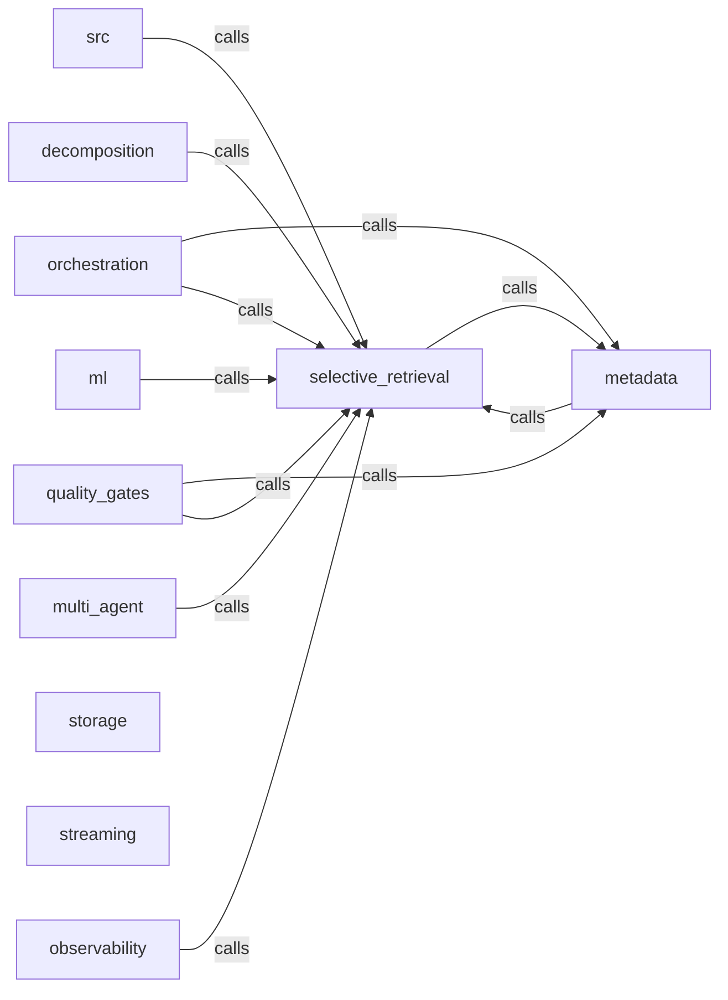

_Generated by CodeAtlas._

## Details

Owns 101 symbols across 9 file(s).

### decomposition

Owns 18 symbols across 2 file(s).

**Related Classes/Methods:** _None_

**Source Files:**

- `core/src/decomposition/query_decomposer.rs`
  - `core.src.decomposition.query_decomposer.DecomposedQuery`
  - `core.src.decomposition.query_decomposer.ExecutionPlan`
  - `core.src.decomposition.query_decomposer.QueryDecomposer`
  - `core.src.decomposition.query_decomposer.QueryDecomposer.calculate_complexity`
  - `core.src.decomposition.query_decomposer.QueryDecomposer.choose_strategy`
  - `core.src.decomposition.query_decomposer.QueryDecomposer.decompose`
  - `core.src.decomposition.query_decomposer.QueryDecomposer.estimate_tokens`
  - `core.src.decomposition.query_decomposer.QueryDecomposer.extract_sources`
  - `core.src.decomposition.query_decomposer.QueryDecomposer.find_parallelizable_steps`
  - `core.src.decomposition.query_decomposer.QueryDecomposer.optimize_execution_plan`
  - `core.src.decomposition.query_decomposer.QueryDecomposer.split_query`
  - `core.src.decomposition.query_decomposer.QueryStep`
  - `core.src.decomposition.query_decomposer.tests.test_complexity_score`
  - `core.src.decomposition.query_decomposer.tests.test_execution_plan_generation`
  - `core.src.decomposition.query_decomposer.tests.test_multi_step_query`
  - `core.src.decomposition.query_decomposer.tests.test_single_step_query`
  - `core.src.decomposition.query_decomposer.tests.test_source_extraction`
  - `core.src.decomposition.query_decomposer.tests.test_token_estimation`

### metadata

Owns 76 symbols across 5 file(s).

**Related Classes/Methods:** _None_

**Source Files:**

- `core/src/metadata/cache.rs`
  - `core.src.metadata.cache.CacheConfig`
  - `core.src.metadata.cache.CacheConfig.default`
  - `core.src.metadata.cache.CacheEntry`
  - `core.src.metadata.cache.CacheEntry.is_expired`
  - `core.src.metadata.cache.CacheStatistics`
  - `core.src.metadata.cache.CacheStats`
  - `core.src.metadata.cache.MetadataCache`
  - `core.src.metadata.cache.MetadataCache.clear`
  - `core.src.metadata.cache.MetadataCache.get`
  - `core.src.metadata.cache.MetadataCache.make_key`
  - `core.src.metadata.cache.MetadataCache.memory_usage`
  - `core.src.metadata.cache.MetadataCache.new`
  - `core.src.metadata.cache.MetadataCache.set`
  - `core.src.metadata.cache.MetadataCache.size`
  - `core.src.metadata.cache.MetadataCache.stats`
  - `core.src.metadata.cache.tests.test_cache_clear`
  - `core.src.metadata.cache.tests.test_cache_eviction`
  - `core.src.metadata.cache.tests.test_cache_set_get`
- `core/src/metadata/filter.rs`
  - `core.src.metadata.filter.FilterConfig`
  - `core.src.metadata.filter.FilterConfig.default`
  - `core.src.metadata.filter.MetadataFilter`
  - `core.src.metadata.filter.MetadataFilter.calculate_adjustments`
  - `core.src.metadata.filter.MetadataFilter.capability_match_score`
  - `core.src.metadata.filter.MetadataFilter.column_match_score`
  - `core.src.metadata.filter.MetadataFilter.create_justification`
  - `core.src.metadata.filter.MetadataFilter.detect_capabilities`
  - `core.src.metadata.filter.MetadataFilter.detect_domain_tags`
  - `core.src.metadata.filter.MetadataFilter.detect_fields`
  - `core.src.metadata.filter.MetadataFilter.extract_query_features`
  - `core.src.metadata.filter.MetadataFilter.new`
  - `core.src.metadata.filter.MetadataFilter.rank`
  - `core.src.metadata.filter.MetadataFilter.score_candidate`
  - `core.src.metadata.filter.QueryFeatures`
  - `core.src.metadata.filter.RankingStrategy`
  - `core.src.metadata.filter.tests.test_extract_query_features`
  - `core.src.metadata.filter.tests.test_rank_web_candidates`
- `core/src/metadata/mod.rs`
  - `core.src.metadata.mod.MetadataIntelligence`
  - `core.src.metadata.mod.MetadataIntelligence.cache_stats`
  - `core.src.metadata.mod.MetadataIntelligence.clear_cache`
  - `core.src.metadata.mod.MetadataIntelligence.get_top_candidates`
  - `core.src.metadata.mod.MetadataIntelligence.new`
  - `core.src.metadata.mod.MetadataIntelligence.rank_candidates`
- `core/src/metadata/profiles.rs`
  - `core.src.metadata.profiles.DatabaseProfiles`
  - `core.src.metadata.profiles.DatabaseProfiles.get_profiles`
  - `core.src.metadata.profiles.DatabaseProfiles.score`
  - `core.src.metadata.profiles.MCPToolProfiles`
  - `core.src.metadata.profiles.MCPToolProfiles.get_profiles`
  - `core.src.metadata.profiles.MCPToolProfiles.score`
  - `core.src.metadata.profiles.WebProfiles`
  - `core.src.metadata.profiles.WebProfiles.get_profiles`
  - `core.src.metadata.profiles.WebProfiles.score`
  - `core.src.metadata.profiles.tests.test_database_profiles_populated`
  - `core.src.metadata.profiles.tests.test_database_scoring`
  - `core.src.metadata.profiles.tests.test_mcp_tool_profiles_populated`
  - `core.src.metadata.profiles.tests.test_mcp_tool_scoring`
  - `core.src.metadata.profiles.tests.test_web_profiles_populated`
  - `core.src.metadata.profiles.tests.test_web_scoring`
- `core/src/metadata/types.rs`
  - `core.src.metadata.types.ColumnMetadata`
  - `core.src.metadata.types.DatabaseMetadata`
  - `core.src.metadata.types.MCPToolMetadata`
  - `core.src.metadata.types.Metadata`
  - `core.src.metadata.types.Metadata.estimated_tokens`
  - `core.src.metadata.types.Metadata.id`
  - `core.src.metadata.types.Metadata.quality`
  - `core.src.metadata.types.Metadata.source_type`
  - `core.src.metadata.types.MetadataProfile`
  - `core.src.metadata.types.QualityWeights`
  - `core.src.metadata.types.QualityWeights.default`
  - `core.src.metadata.types.RankedCandidate`
  - `core.src.metadata.types.SourceQuality`
  - `core.src.metadata.types.SourceQuality.overall_score`
  - `core.src.metadata.types.SourceType`
  - `core.src.metadata.types.WebMetadata`
  - `core.src.metadata.types.database_quality`
  - `core.src.metadata.types.tool_quality`
  - `core.src.metadata.types.web_quality`

### ml

Owns 18 symbols across 2 file(s).

**Related Classes/Methods:** _None_

**Source Files:**

- `core/src/ml/learned_relevance.rs`
  - `core.src.ml.learned_relevance.FeedbackType`
  - `core.src.ml.learned_relevance.LearnedRelevanceModel`
  - `core.src.ml.learned_relevance.LearnedRelevanceModel.accuracy_percent`
  - `core.src.ml.learned_relevance.LearnedRelevanceModel.add_sample`
  - `core.src.ml.learned_relevance.LearnedRelevanceModel.feedback_to_score`
  - `core.src.ml.learned_relevance.LearnedRelevanceModel.new`
  - `core.src.ml.learned_relevance.LearnedRelevanceModel.predict_relevance`
  - `core.src.ml.learned_relevance.LearnedRelevanceModel.score_query_source_match`
  - `core.src.ml.learned_relevance.LearnedRelevanceModel.train`
  - `core.src.ml.learned_relevance.LearnedRelevanceModel.update_with_feedback`
  - `core.src.ml.learned_relevance.TrainingSample`
  - `core.src.ml.learned_relevance.UserFeedback`
  - `core.src.ml.learned_relevance.tests.test_add_sample`
  - `core.src.ml.learned_relevance.tests.test_feedback_to_score`
  - `core.src.ml.learned_relevance.tests.test_new_model`
  - `core.src.ml.learned_relevance.tests.test_predict_relevance`
  - `core.src.ml.learned_relevance.tests.test_train_model`
  - `core.src.ml.learned_relevance.tests.test_update_with_feedback`

### multi_agent

Owns 21 symbols across 2 file(s).

**Related Classes/Methods:** _None_

**Source Files:**

- `core/src/multi_agent/context_hub.rs`
  - `core.src.multi_agent.context_hub.ContextHub`
  - `core.src.multi_agent.context_hub.ContextHub.agent_collaboration_score`
  - `core.src.multi_agent.context_hub.ContextHub.agent_count`
  - `core.src.multi_agent.context_hub.ContextHub.collaboration_savings`
  - `core.src.multi_agent.context_hub.ContextHub.context_count`
  - `core.src.multi_agent.context_hub.ContextHub.default`
  - `core.src.multi_agent.context_hub.ContextHub.get_context`
  - `core.src.multi_agent.context_hub.ContextHub.new`
  - `core.src.multi_agent.context_hub.ContextHub.query_shared_contexts`
  - `core.src.multi_agent.context_hub.ContextHub.register_context`
  - `core.src.multi_agent.context_hub.ContextHub.update_usage`
  - `core.src.multi_agent.context_hub.SharedContext`
  - `core.src.multi_agent.context_hub.SharedContext.add_agent`
  - `core.src.multi_agent.context_hub.SharedContext.new`
  - `core.src.multi_agent.context_hub.SharedContext.reuse_factor`
  - `core.src.multi_agent.context_hub.levenshtein_distance`
  - `core.src.multi_agent.context_hub.tests.test_collaboration_score`
  - `core.src.multi_agent.context_hub.tests.test_context_hub_register`
  - `core.src.multi_agent.context_hub.tests.test_query_shared_contexts`
  - `core.src.multi_agent.context_hub.tests.test_shared_context_creation`
  - `core.src.multi_agent.context_hub.tests.test_update_usage`

### observability

Owns 81 symbols across 5 file(s).

**Related Classes/Methods:** _None_

**Source Files:**

- `core/src/observability/audit.rs`
  - `core.src.observability.audit.AuditReport`
  - `core.src.observability.audit.DecisionAuditTrail`
  - `core.src.observability.audit.DecisionAuditTrail.generate_report`
  - `core.src.observability.audit.DecisionAuditTrail.get_decisions_by_stage`
  - `core.src.observability.audit.DecisionAuditTrail.get_decisions_for_trace`
  - `core.src.observability.audit.DecisionAuditTrail.get_total_decisions`
  - `core.src.observability.audit.DecisionAuditTrail.new`
  - `core.src.observability.audit.DecisionAuditTrail.record_decision`
  - `core.src.observability.audit.DecisionRecord`
  - `core.src.observability.audit.tests.test_generate_report`
  - `core.src.observability.audit.tests.test_record_decision`
- `core/src/observability/logging.rs`
  - `core.src.observability.logging.AuditLog`
  - `core.src.observability.logging.LogLevel`
  - `core.src.observability.logging.LogLevel.fmt`
  - `core.src.observability.logging.StructuredLogger`
  - `core.src.observability.logging.StructuredLogger.debug`
  - `core.src.observability.logging.StructuredLogger.error`
  - `core.src.observability.logging.StructuredLogger.info`
  - `core.src.observability.logging.StructuredLogger.log`
  - `core.src.observability.logging.StructuredLogger.new`
  - `core.src.observability.logging.StructuredLogger.warn`
  - `core.src.observability.logging.tests.test_structured_logger`
- `core/src/observability/metrics.rs`
  - `core.src.observability.metrics.MetricsCollector`
  - `core.src.observability.metrics.MetricsCollector.export_json`
  - `core.src.observability.metrics.MetricsCollector.export_prometheus`
  - `core.src.observability.metrics.MetricsCollector.get_cache_hit_rate`
  - `core.src.observability.metrics.MetricsCollector.get_metrics`
  - `core.src.observability.metrics.MetricsCollector.new`
  - `core.src.observability.metrics.MetricsCollector.record_cache_hit`
  - `core.src.observability.metrics.MetricsCollector.record_cache_miss`
  - `core.src.observability.metrics.MetricsCollector.record_fallback`
  - `core.src.observability.metrics.MetricsCollector.record_stage_performance`
  - `core.src.observability.metrics.PerformanceMetrics`
  - `core.src.observability.metrics.ReductionMetrics`
  - `core.src.observability.metrics.StageMetrics`
  - `core.src.observability.metrics.tests.test_cache_metrics`
  - `core.src.observability.metrics.tests.test_metrics_collection`
- `core/src/observability/mod.rs`
  - `core.src.observability.mod.AuditConfig`
  - `core.src.observability.mod.AuditConfig.default`
  - `core.src.observability.mod.LogConfig`
  - `core.src.observability.mod.LogConfig.default`
  - `core.src.observability.mod.MetricsConfig`
  - `core.src.observability.mod.MetricsConfig.default`
  - `core.src.observability.mod.ObservabilityConfig`
  - `core.src.observability.mod.ObservabilityConfig.default`
  - `core.src.observability.mod.ObservabilityEngine`
  - `core.src.observability.mod.ObservabilityEngine.export_metrics`
  - `core.src.observability.mod.ObservabilityEngine.get_performance_metrics`
  - `core.src.observability.mod.ObservabilityEngine.get_query_audit_trail`
  - `core.src.observability.mod.ObservabilityEngine.new`
  - `core.src.observability.mod.ObservabilityEngine.record_performance`
  - `core.src.observability.mod.ObservabilityEngine.record_stage1_decision`
  - `core.src.observability.mod.ObservabilityEngine.record_stage2_decision`
  - `core.src.observability.mod.ObservabilityEngine.record_stage3_decision`
  - `core.src.observability.mod.ObservabilityEngine.start_query_trace`
  - `core.src.observability.mod.QueryTrace`
  - `core.src.observability.mod.StageTrace`
  - `core.src.observability.mod.TraceConfig`
  - `core.src.observability.mod.TraceConfig.default`
  - `core.src.observability.mod.tests.test_observability_engine_creation`
  - `core.src.observability.mod.tests.test_record_decisions`
  - `core.src.observability.mod.tests.test_record_performance`
- `core/src/observability/tracing.rs`
  - `core.src.observability.tracing.DecisionTracer`
  - `core.src.observability.tracing.DecisionTracer.add_span_attribute`
  - `core.src.observability.tracing.DecisionTracer.add_span_event`
  - `core.src.observability.tracing.DecisionTracer.complete_span`
  - `core.src.observability.tracing.DecisionTracer.create_child_span`
  - `core.src.observability.tracing.DecisionTracer.create_context`
  - `core.src.observability.tracing.DecisionTracer.create_root_span`
  - `core.src.observability.tracing.DecisionTracer.export_span`
  - `core.src.observability.tracing.DecisionTracer.generate_span_id`
  - `core.src.observability.tracing.DecisionTracer.generate_trace_id`
  - `core.src.observability.tracing.DecisionTracer.new`
  - `core.src.observability.tracing.SpanEvent`
  - `core.src.observability.tracing.SpanStatus`
  - `core.src.observability.tracing.TraceContext`
  - `core.src.observability.tracing.TraceSpan`
  - `core.src.observability.tracing.tests.test_create_child_span`
  - `core.src.observability.tracing.tests.test_create_context`
  - `core.src.observability.tracing.tests.test_span_lifecycle`
  - `core.src.observability.tracing.tests.test_trace_id_generation`

### orchestration

Owns 208 symbols across 10 file(s).

**Related Classes/Methods:** _None_

**Source Files:**

- `core/src/orchestration/complexity.rs`
  - `core.src.orchestration.complexity.ComplexityDetector`
  - `core.src.orchestration.complexity.ComplexityDetector.analytical_terms`
  - `core.src.orchestration.complexity.ComplexityDetector.classify`
  - `core.src.orchestration.complexity.ComplexityDetector.confidence`
  - `core.src.orchestration.complexity.ComplexityDetector.detect`
  - `core.src.orchestration.complexity.ComplexityDetector.has_aggregations`
  - `core.src.orchestration.complexity.ComplexityDetector.has_filters`
  - `core.src.orchestration.complexity.ComplexityDetector.requires_spatial`
  - `core.src.orchestration.complexity.ComplexityDetector.requires_temporal`
  - `core.src.orchestration.complexity.ComplexityTier`
  - `core.src.orchestration.complexity.ComplexityTier.source_strategy`
  - `core.src.orchestration.complexity.ComplexityTier.token_multiplier`
  - `core.src.orchestration.complexity.QueryComplexity`
  - `core.src.orchestration.complexity.SourceStrategy`
  - `core.src.orchestration.complexity.tests.test_complex_query_detection`
  - `core.src.orchestration.complexity.tests.test_simple_query_detection`
  - `core.src.orchestration.complexity.tests.test_source_strategies`
  - `core.src.orchestration.complexity.tests.test_token_multipliers`
  - `core.src.orchestration.complexity.tests.test_very_complex_query_detection`
- `core/src/orchestration/error.rs`
  - `core.src.orchestration.error.OrchestrationError`
  - `core.src.orchestration.error.OrchestrationError.fmt`
  - `core.src.orchestration.error.tests.test_error_display`
  - `core.src.orchestration.error.tests.test_error_serialization`
- `core/src/orchestration/metrics.rs`
  - `core.src.orchestration.metrics.Availability`
  - `core.src.orchestration.metrics.Availability.as_f32`
  - `core.src.orchestration.metrics.Availability.is_available`
  - `core.src.orchestration.metrics.Availability.new`
  - `core.src.orchestration.metrics.Availability.validate`
  - `core.src.orchestration.metrics.Confidence`
  - `core.src.orchestration.metrics.Confidence.as_f32`
  - `core.src.orchestration.metrics.Confidence.is_confident`
  - `core.src.orchestration.metrics.Confidence.level`
  - `core.src.orchestration.metrics.Confidence.new`
  - `core.src.orchestration.metrics.Confidence.validate`
  - `core.src.orchestration.metrics.ConfidenceLevel`
  - `core.src.orchestration.metrics.ConfidenceLevel.fmt`
  - `core.src.orchestration.metrics.Cost`
  - `core.src.orchestration.metrics.Cost.as_tokens`
  - `core.src.orchestration.metrics.Cost.is_within_budget`
  - `core.src.orchestration.metrics.Cost.new`
  - `core.src.orchestration.metrics.Cost.score`
  - `core.src.orchestration.metrics.Cost.validate`
  - `core.src.orchestration.metrics.Expertise`
  - `core.src.orchestration.metrics.Expertise.as_f32`
  - `core.src.orchestration.metrics.Expertise.is_expert`
  - `core.src.orchestration.metrics.Expertise.new`
  - `core.src.orchestration.metrics.Expertise.validate`
  - `core.src.orchestration.metrics.Freshness`
  - `core.src.orchestration.metrics.Freshness.as_f32`
  - `core.src.orchestration.metrics.Freshness.is_fresh`
  - `core.src.orchestration.metrics.Freshness.new`
  - `core.src.orchestration.metrics.Freshness.validate`
  - `core.src.orchestration.metrics.Latency`
  - `core.src.orchestration.metrics.Latency.as_ms`
  - `core.src.orchestration.metrics.Latency.as_secs`
  - `core.src.orchestration.metrics.Latency.is_acceptable`
  - `core.src.orchestration.metrics.Latency.new`
  - `core.src.orchestration.metrics.Latency.score`
  - `core.src.orchestration.metrics.Latency.unchecked`
  - `core.src.orchestration.metrics.Latency.validate`
  - `core.src.orchestration.metrics.Score`
  - `core.src.orchestration.metrics.Score.as_f32`
  - `core.src.orchestration.metrics.Score.as_percent`
  - `core.src.orchestration.metrics.Score.new`
  - `core.src.orchestration.metrics.Score.unchecked`
  - `core.src.orchestration.metrics.Score.validate`
  - `core.src.orchestration.metrics.SuccessRate`
  - `core.src.orchestration.metrics.SuccessRate.as_f32`
  - `core.src.orchestration.metrics.SuccessRate.as_percent`
  - `core.src.orchestration.metrics.SuccessRate.is_high`
  - `core.src.orchestration.metrics.SuccessRate.new`
  - `core.src.orchestration.metrics.SuccessRate.validate`
  - `core.src.orchestration.metrics.tests.test_confidence_level`
  - `core.src.orchestration.metrics.tests.test_cost_score`
  - `core.src.orchestration.metrics.tests.test_latency_score`
  - `core.src.orchestration.metrics.tests.test_score_new_invalid`
  - `core.src.orchestration.metrics.tests.test_score_new_valid`
- `core/src/orchestration/multimodal.rs`
  - `core.src.orchestration.multimodal.FeedbackAggregator`
  - `core.src.orchestration.multimodal.FeedbackAggregator.count_feedbacks`
  - `core.src.orchestration.multimodal.FeedbackAggregator.default`
  - `core.src.orchestration.multimodal.FeedbackAggregator.get_query_patterns`
  - `core.src.orchestration.multimodal.FeedbackAggregator.get_source_reliability`
  - `core.src.orchestration.multimodal.FeedbackAggregator.new`
  - `core.src.orchestration.multimodal.FeedbackAggregator.record_feedback`
  - `core.src.orchestration.multimodal.FeedbackLoop`
  - `core.src.orchestration.multimodal.FusionMethod`
  - `core.src.orchestration.multimodal.MultiModalRanker`
  - `core.src.orchestration.multimodal.MultiModalRanker.borda_count`
  - `core.src.orchestration.multimodal.MultiModalRanker.calculate_collaborative_score`
  - `core.src.orchestration.multimodal.MultiModalRanker.calculate_content_score`
  - `core.src.orchestration.multimodal.MultiModalRanker.calculate_expertise_score`
  - `core.src.orchestration.multimodal.MultiModalRanker.calculate_semantic_score`
  - `core.src.orchestration.multimodal.MultiModalRanker.calculate_temporal_score`
  - `core.src.orchestration.multimodal.MultiModalRanker.conductor_based`
  - `core.src.orchestration.multimodal.MultiModalRanker.default`
  - `core.src.orchestration.multimodal.MultiModalRanker.fuse_scores`
  - `core.src.orchestration.multimodal.MultiModalRanker.new`
  - `core.src.orchestration.multimodal.MultiModalRanker.reciprocal_rank_fusion`
  - `core.src.orchestration.multimodal.MultiModalRanker.rerank`
  - `core.src.orchestration.multimodal.MultiModalScore`
  - `core.src.orchestration.multimodal.RankingMode`
  - `core.src.orchestration.multimodal.RankingStrategy`
  - `core.src.orchestration.multimodal.tests.test_feedback_aggregator_max_history`
  - `core.src.orchestration.multimodal.tests.test_feedback_recording`
  - `core.src.orchestration.multimodal.tests.test_fusion_methods`
  - `core.src.orchestration.multimodal.tests.test_multimodal_ranker_default`
  - `core.src.orchestration.multimodal.tests.test_query_patterns`
  - `core.src.orchestration.multimodal.tests.test_source_reliability`
- `core/src/orchestration/orchestrator.rs`
  - `core.src.orchestration.orchestrator.OrchestrationConfig`
  - `core.src.orchestration.orchestrator.OrchestrationConfig.default`
  - `core.src.orchestration.orchestrator.OrchestrationResult`
  - `core.src.orchestration.orchestrator.RetrievalOrchestrator`
  - `core.src.orchestration.orchestrator.RetrievalOrchestrator.calculate_adjustments`
  - `core.src.orchestration.orchestrator.RetrievalOrchestrator.calculate_token_budget`
  - `core.src.orchestration.orchestrator.RetrievalOrchestrator.complexity_tier_name`
  - `core.src.orchestration.orchestrator.RetrievalOrchestrator.estimate_complexity`
  - `core.src.orchestration.orchestrator.RetrievalOrchestrator.new`
  - `core.src.orchestration.orchestrator.RetrievalOrchestrator.orchestrate`
  - `core.src.orchestration.orchestrator.RetrievalOrchestrator.source_strategy_name`
  - `core.src.orchestration.orchestrator.RetrievalOrchestrator.stage1_filtering`
  - `core.src.orchestration.orchestrator.RetrievalOrchestrator.stage2_reranking`
  - `core.src.orchestration.orchestrator.Stage1Decision`
  - `core.src.orchestration.orchestrator.Stage2Decision`
  - `core.src.orchestration.orchestrator.tests.test_complexity_estimation_complex`
  - `core.src.orchestration.orchestrator.tests.test_complexity_estimation_simple`
  - `core.src.orchestration.orchestrator.tests.test_complexity_tier_names`
  - `core.src.orchestration.orchestrator.tests.test_orchestration_config_default`
  - `core.src.orchestration.orchestrator.tests.test_orchestrator_creation`
  - `core.src.orchestration.orchestrator.tests.test_token_budget_calculation`
- `core/src/orchestration/reranking.rs`
  - `core.src.orchestration.reranking.ContextualReranker`
  - `core.src.orchestration.reranking.ContextualReranker.calculate_adjustment`
  - `core.src.orchestration.reranking.ContextualReranker.generate_reason`
  - `core.src.orchestration.reranking.ContextualReranker.new`
  - `core.src.orchestration.reranking.ContextualReranker.rerank`
  - `core.src.orchestration.reranking.ContextualReranker.with_user_context`
  - `core.src.orchestration.reranking.ExpertiseLevel`
  - `core.src.orchestration.reranking.RerankedCandidate`
  - `core.src.orchestration.reranking.UserContext`
  - `core.src.orchestration.reranking.tests.test_candidate`
  - `core.src.orchestration.reranking.tests.test_expertise_adjustment_beginner`
  - `core.src.orchestration.reranking.tests.test_expertise_adjustment_expert`
  - `core.src.orchestration.reranking.tests.test_reranker_creation`
  - `core.src.orchestration.reranking.tests.test_reranker_with_user_context`
- `core/src/orchestration/token_filter.rs`
  - `core.src.orchestration.token_filter.ContentSegment`
  - `core.src.orchestration.token_filter.RankedContent`
  - `core.src.orchestration.token_filter.RelevanceRanker`
  - `core.src.orchestration.token_filter.RelevanceRanker.calculate_relevance`
  - `core.src.orchestration.token_filter.RelevanceRanker.keyword_match_ratio`
  - `core.src.orchestration.token_filter.RelevanceRanker.new`
  - `core.src.orchestration.token_filter.RelevanceRanker.rank_content`
  - `core.src.orchestration.token_filter.TokenBudget`
  - `core.src.orchestration.token_filter.TokenBudget.add_critical_keywords`
  - `core.src.orchestration.token_filter.TokenBudget.allocate`
  - `core.src.orchestration.token_filter.TokenBudget.get_adjusted_budget`
  - `core.src.orchestration.token_filter.TokenBudget.new`
  - `core.src.orchestration.token_filter.TokenBudget.remaining`
  - `core.src.orchestration.token_filter.TokenFilter`
  - `core.src.orchestration.token_filter.TokenFilter.filter_to_budget`
  - `core.src.orchestration.token_filter.TokenFilterResult`
  - `core.src.orchestration.token_filter.tests.test_content_segment_creation`
  - `core.src.orchestration.token_filter.tests.test_relevance_ranker_creation`
  - `core.src.orchestration.token_filter.tests.test_token_allocation`
  - `core.src.orchestration.token_filter.tests.test_token_budget_creation`
  - `core.src.orchestration.token_filter.tests.test_token_overallocation`
- `core/src/orchestration/traits.rs`
  - `core.src.orchestration.traits.Confidence`
  - `core.src.orchestration.traits.ConfidentScore`
  - `core.src.orchestration.traits.Explainable`
  - `core.src.orchestration.traits.ExplainedChoice`
  - `core.src.orchestration.traits.FullyObservable`
  - `core.src.orchestration.traits.HasAlternatives`
  - `core.src.orchestration.traits.PerformanceMetric`
  - `core.src.orchestration.traits.Queryable`
  - `core.src.orchestration.traits.Rankable`
  - `core.src.orchestration.traits.RankedScore`
  - `core.src.orchestration.traits.Scoreable`
  - `core.src.orchestration.traits.Validatable`
  - `core.src.orchestration.traits.tests.MockScore`
  - `core.src.orchestration.traits.tests.MockScore.score`
  - `core.src.orchestration.traits.tests.MockScore.score_explanation`
  - `core.src.orchestration.traits.tests.test_confidence`
  - `core.src.orchestration.traits.tests.test_confidence.MockConfidence`
  - `core.src.orchestration.traits.tests.test_confidence.MockConfidence.confidence`
  - `core.src.orchestration.traits.tests.test_scoreable_validate_score`
- `core/src/orchestration/validation.rs`
  - `core.src.orchestration.validation.BatchValidator`
  - `core.src.orchestration.validation.BatchValidator.errors`
  - `core.src.orchestration.validation.BatchValidator.finish`
  - `core.src.orchestration.validation.BatchValidator.has_errors`
  - `core.src.orchestration.validation.BatchValidator.new`
  - `core.src.orchestration.validation.BatchValidator.validate_item`
  - `core.src.orchestration.validation.InputValidator`
  - `core.src.orchestration.validation.InputValidator.default`
  - `core.src.orchestration.validation.InputValidator.new`
  - `core.src.orchestration.validation.InputValidator.validate_capability_name`
  - `core.src.orchestration.validation.InputValidator.validate_collection`
  - `core.src.orchestration.validation.InputValidator.validate_latency`
  - `core.src.orchestration.validation.InputValidator.validate_query`
  - `core.src.orchestration.validation.InputValidator.validate_score`
  - `core.src.orchestration.validation.InputValidator.validate_server_id`
  - `core.src.orchestration.validation.ValidationConfig`
  - `core.src.orchestration.validation.ValidationConfig.default`
  - `core.src.orchestration.validation.tests.test_batch_validator`
  - `core.src.orchestration.validation.tests.test_validate_query_empty`
  - `core.src.orchestration.validation.tests.test_validate_query_too_long`
  - `core.src.orchestration.validation.tests.test_validate_query_valid`
  - `core.src.orchestration.validation.tests.test_validate_score_invalid`
  - `core.src.orchestration.validation.tests.test_validate_score_valid`
  - `core.src.orchestration.validation.tests.test_validate_server_id_invalid_chars`
  - `core.src.orchestration.validation.tests.test_validate_server_id_valid`

### quality_gates

Owns 84 symbols across 5 file(s).

**Related Classes/Methods:** _None_

**Source Files:**

- `core/src/quality_gates/confidence.rs`
  - `core.src.quality_gates.confidence.ConfidenceCalculator`
  - `core.src.quality_gates.confidence.ConfidenceCalculator.calculate_content_confidence`
  - `core.src.quality_gates.confidence.ConfidenceCalculator.calculate_quality_score`
  - `core.src.quality_gates.confidence.ConfidenceCalculator.calculate_source_confidence`
  - `core.src.quality_gates.confidence.ConfidenceCalculator.estimate_from_context`
  - `core.src.quality_gates.confidence.ConfidenceCalculator.get_weight_for_check_type`
  - `core.src.quality_gates.confidence.ConfidenceCalculator.new`
  - `core.src.quality_gates.confidence.ConfidenceLevel`
  - `core.src.quality_gates.confidence.ConfidenceLevel.fmt`
  - `core.src.quality_gates.confidence.ConfidenceScore`
  - `core.src.quality_gates.confidence.ConfidenceScore.is_acceptable`
  - `core.src.quality_gates.confidence.ConfidenceScore.level`
  - `core.src.quality_gates.confidence.ConfidenceScore.new`
  - `core.src.quality_gates.confidence.tests.test_calculate_quality_score`
  - `core.src.quality_gates.confidence.tests.test_confidence_level`
  - `core.src.quality_gates.confidence.tests.test_confidence_score_bounds`
  - `core.src.quality_gates.confidence.tests.test_is_acceptable`
- `core/src/quality_gates/fallback.rs`
  - `core.src.quality_gates.fallback.FallbackChain`
  - `core.src.quality_gates.fallback.FallbackChain.new`
  - `core.src.quality_gates.fallback.FallbackChain.recommend_fallback`
  - `core.src.quality_gates.fallback.FallbackChain.register_alternatives`
  - `core.src.quality_gates.fallback.FallbackChain.strategies`
  - `core.src.quality_gates.fallback.FallbackChain.try_strategy`
  - `core.src.quality_gates.fallback.FallbackResult`
  - `core.src.quality_gates.fallback.FallbackStrategy`
  - `core.src.quality_gates.fallback.tests.test_recommend_fallback`
  - `core.src.quality_gates.fallback.tests.test_register_alternatives`
  - `core.src.quality_gates.fallback.tests.test_strategies_list`
- `core/src/quality_gates/mod.rs`
  - `core.src.quality_gates.mod.ConfidenceConfig`
  - `core.src.quality_gates.mod.ConfidenceConfig.default`
  - `core.src.quality_gates.mod.ContentValidationResult`
  - `core.src.quality_gates.mod.ContextItem`
  - `core.src.quality_gates.mod.ContextWindowValidation`
  - `core.src.quality_gates.mod.ItemValidationDetail`
  - `core.src.quality_gates.mod.QualityGatesConfig`
  - `core.src.quality_gates.mod.QualityGatesConfig.default`
  - `core.src.quality_gates.mod.QualityGatesEngine`
  - `core.src.quality_gates.mod.QualityGatesEngine.check_sla`
  - `core.src.quality_gates.mod.QualityGatesEngine.get_fallback_recommendation`
  - `core.src.quality_gates.mod.QualityGatesEngine.new`
  - `core.src.quality_gates.mod.QualityGatesEngine.validate_content`
  - `core.src.quality_gates.mod.QualityGatesEngine.validate_context_window`
  - `core.src.quality_gates.mod.QualityGatesEngine.validate_source`
  - `core.src.quality_gates.mod.SLACheckResult`
  - `core.src.quality_gates.mod.SourceValidationResult`
- `core/src/quality_gates/policies.rs`
  - `core.src.quality_gates.policies.PolicyEnforcementResult`
  - `core.src.quality_gates.policies.PolicyEnforcer`
  - `core.src.quality_gates.policies.PolicyEnforcer.check_sla`
  - `core.src.quality_gates.policies.PolicyEnforcer.clear_violations`
  - `core.src.quality_gates.policies.PolicyEnforcer.enforce_policy`
  - `core.src.quality_gates.policies.PolicyEnforcer.get_compliance_rate`
  - `core.src.quality_gates.policies.PolicyEnforcer.new`
  - `core.src.quality_gates.policies.PolicyEnforcer.record_violations`
  - `core.src.quality_gates.policies.PolicyEnforcer.update_policy`
  - `core.src.quality_gates.policies.PolicyEnforcer.violation_history`
  - `core.src.quality_gates.policies.PolicyViolation`
  - `core.src.quality_gates.policies.QualityPolicy`
  - `core.src.quality_gates.policies.QualityPolicy.default`
  - `core.src.quality_gates.policies.SLAConfig`
  - `core.src.quality_gates.policies.SLAConfig.default`
  - `core.src.quality_gates.policies.tests.test_check_sla_fail_latency`
  - `core.src.quality_gates.policies.tests.test_check_sla_fail_quality`
  - `core.src.quality_gates.policies.tests.test_check_sla_pass`
  - `core.src.quality_gates.policies.tests.test_enforce_policy_relaxed`
  - `core.src.quality_gates.policies.tests.test_enforce_policy_strict`
  - `core.src.quality_gates.policies.tests.test_violation_history`
- `core/src/quality_gates/validators.rs`
  - `core.src.quality_gates.validators.CheckType`
  - `core.src.quality_gates.validators.QualityValidator`
  - `core.src.quality_gates.validators.QualityValidator.default`
  - `core.src.quality_gates.validators.QualityValidator.new`
  - `core.src.quality_gates.validators.QualityValidator.validate_content_length`
  - `core.src.quality_gates.validators.QualityValidator.validate_format`
  - `core.src.quality_gates.validators.QualityValidator.validate_item`
  - `core.src.quality_gates.validators.QualityValidator.validate_retrieved_content`
  - `core.src.quality_gates.validators.QualityValidator.validate_signal_to_noise`
  - `core.src.quality_gates.validators.QualityValidator.validate_source_metadata`
  - `core.src.quality_gates.validators.QualityValidator.validate_source_type`
  - `core.src.quality_gates.validators.ValidationCheck`
  - `core.src.quality_gates.validators.ValidationResult`
  - `core.src.quality_gates.validators.tests.test_validate_content_empty`
  - `core.src.quality_gates.validators.tests.test_validate_content_valid`
  - `core.src.quality_gates.validators.tests.test_validate_signal_to_noise`
  - `core.src.quality_gates.validators.tests.test_validate_source_metadata`
  - `core.src.quality_gates.validators.tests.test_validate_source_type`

### selective_retrieval

Owns 81 symbols across 6 file(s).

**Related Classes/Methods:** _None_

**Source Files:**

- `core/src/selective_retrieval/budgets.rs`
  - `core.src.selective_retrieval.budgets.BudgetConfig`
  - `core.src.selective_retrieval.budgets.BudgetConfig.default`
  - `core.src.selective_retrieval.budgets.BudgetStats`
  - `core.src.selective_retrieval.budgets.BudgetTier`
  - `core.src.selective_retrieval.budgets.BudgetTier.max`
  - `core.src.selective_retrieval.budgets.BudgetTier.min`
  - `core.src.selective_retrieval.budgets.BudgetTier.multiplier_ceiling`
  - `core.src.selective_retrieval.budgets.BudgetTier.name`
  - `core.src.selective_retrieval.budgets.TokenBudget`
  - `core.src.selective_retrieval.budgets.TokenBudget.allocate_for_intent`
  - `core.src.selective_retrieval.budgets.TokenBudget.assign_tier`
  - `core.src.selective_retrieval.budgets.TokenBudget.budget_stats`
  - `core.src.selective_retrieval.budgets.TokenBudget.calculate_final_budget`
  - `core.src.selective_retrieval.budgets.TokenBudget.new`
  - `core.src.selective_retrieval.budgets.TokenBudget.select_within_budget`
  - `core.src.selective_retrieval.budgets.tests.test_intent_allocation`
  - `core.src.selective_retrieval.budgets.tests.test_multiplier_expansion`
  - `core.src.selective_retrieval.budgets.tests.test_select_within_budget`
  - `core.src.selective_retrieval.budgets.tests.test_tier_assignment`
- `core/src/selective_retrieval/intent.rs`
  - `core.src.selective_retrieval.intent.IntentClassifier`
  - `core.src.selective_retrieval.intent.IntentClassifier.classify`
  - `core.src.selective_retrieval.intent.IntentClassifier.default`
  - `core.src.selective_retrieval.intent.IntentClassifier.detect_complexity`
  - `core.src.selective_retrieval.intent.IntentClassifier.new`
  - `core.src.selective_retrieval.intent.tests.test_complexity_detection`
  - `core.src.selective_retrieval.intent.tests.test_entity_detection`
  - `core.src.selective_retrieval.intent.tests.test_intent_classification`
- `core/src/selective_retrieval/mod.rs`
  - `core.src.selective_retrieval.mod.SelectiveRetrievalConfig`
  - `core.src.selective_retrieval.mod.SelectiveRetrievalConfig.default`
  - `core.src.selective_retrieval.mod.SelectiveRetrievalEngine`
  - `core.src.selective_retrieval.mod.SelectiveRetrievalEngine.filter_context`
  - `core.src.selective_retrieval.mod.SelectiveRetrievalEngine.get_budget`
  - `core.src.selective_retrieval.mod.SelectiveRetrievalEngine.new`
  - `core.src.selective_retrieval.mod.TokenBudgetEstimate`
- `core/src/selective_retrieval/multiplier.rs`
  - `core.src.selective_retrieval.multiplier.MultiplierRule`
  - `core.src.selective_retrieval.multiplier.MultiplierRule.new`
  - `core.src.selective_retrieval.multiplier.MultiplierRule.with_category`
  - `core.src.selective_retrieval.multiplier.TokenMultiplier`
  - `core.src.selective_retrieval.multiplier.TokenMultiplier.add_rule`
  - `core.src.selective_retrieval.multiplier.TokenMultiplier.calculate_multiplier`
  - `core.src.selective_retrieval.multiplier.TokenMultiplier.default_rules`
  - `core.src.selective_retrieval.multiplier.TokenMultiplier.get_rules`
  - `core.src.selective_retrieval.multiplier.TokenMultiplier.get_rules_by_category`
  - `core.src.selective_retrieval.multiplier.TokenMultiplier.new`
  - `core.src.selective_retrieval.multiplier.TokenMultiplier.reset_to_defaults`
  - `core.src.selective_retrieval.multiplier.tests.test_add_custom_rule`
  - `core.src.selective_retrieval.multiplier.tests.test_calculate_multiplier_critical`
  - `core.src.selective_retrieval.multiplier.tests.test_calculate_multiplier_debug`
  - `core.src.selective_retrieval.multiplier.tests.test_calculate_multiplier_financial`
  - `core.src.selective_retrieval.multiplier.tests.test_case_insensitive`
  - `core.src.selective_retrieval.multiplier.tests.test_default_rules`
  - `core.src.selective_retrieval.multiplier.tests.test_get_rules_by_category`
  - `core.src.selective_retrieval.multiplier.tests.test_highest_multiplier_wins`
  - `core.src.selective_retrieval.multiplier.tests.test_no_multiplier`
- `core/src/selective_retrieval/reranker.rs`
  - `core.src.selective_retrieval.reranker.ContextualReranker`
  - `core.src.selective_retrieval.reranker.ContextualReranker.extract_keywords`
  - `core.src.selective_retrieval.reranker.ContextualReranker.is_stopword`
  - `core.src.selective_retrieval.reranker.ContextualReranker.new`
  - `core.src.selective_retrieval.reranker.ContextualReranker.rerank`
  - `core.src.selective_retrieval.reranker.ContextualReranker.score_item`
  - `core.src.selective_retrieval.reranker.RankingCriteria`
  - `core.src.selective_retrieval.reranker.RankingCriteria.for_intent`
  - `core.src.selective_retrieval.reranker.RerankerConfig`
  - `core.src.selective_retrieval.reranker.RerankerConfig.default`
  - `core.src.selective_retrieval.reranker.tests.test_extract_keywords`
  - `core.src.selective_retrieval.reranker.tests.test_ranking_criteria_for_intent`
  - `core.src.selective_retrieval.reranker.tests.test_rerank_items`
- `core/src/selective_retrieval/types.rs`
  - `core.src.selective_retrieval.types.ContentItem`
  - `core.src.selective_retrieval.types.IntentScore`
  - `core.src.selective_retrieval.types.ItemMetadata`
  - `core.src.selective_retrieval.types.ItemType`
  - `core.src.selective_retrieval.types.QueryComplexity`
  - `core.src.selective_retrieval.types.QueryComplexity.fmt`
  - `core.src.selective_retrieval.types.QueryIntent`
  - `core.src.selective_retrieval.types.RankingCriteria`
  - `core.src.selective_retrieval.types.RankingCriteria.default`
  - `core.src.selective_retrieval.types.RerankingScore`
  - `core.src.selective_retrieval.types.RetrievedContent`
  - `core.src.selective_retrieval.types.tests.test_complexity_levels`
  - `core.src.selective_retrieval.types.tests.test_content_item_creation`
  - `core.src.selective_retrieval.types.tests.test_query_intent_classification`

### storage

Owns 9 symbols across 3 file(s).

**Related Classes/Methods:** _None_

**Source Files:**

- `core/src/storage/repository.rs`
  - `core.src.storage.repository.Repository`
  - `core.src.storage.repository.Repository.get_query`
  - `core.src.storage.repository.Repository.new`
  - `core.src.storage.repository.Repository.save_discovery`
  - `core.src.storage.repository.Repository.save_query`
  - `core.src.storage.repository.tests.test_discovery_storage`
  - `core.src.storage.repository.tests.test_query_storage`
- `core/src/storage/schema.rs`
  - `core.src.storage.schema.init_schema`
  - `core.src.storage.schema.tests.test_schema_initialization`

### streaming

Owns 14 symbols across 2 file(s).

**Related Classes/Methods:** _None_

**Source Files:**

- `core/src/streaming/context_stream.rs`
  - `core.src.streaming.context_stream.ContextStream`
  - `core.src.streaming.context_stream.ContextStream.add_chunk`
  - `core.src.streaming.context_stream.ContextStream.chunks_ready`
  - `core.src.streaming.context_stream.ContextStream.completion_percent`
  - `core.src.streaming.context_stream.ContextStream.new`
  - `core.src.streaming.context_stream.ContextStream.next`
  - `core.src.streaming.context_stream.ContextStream.take_until_budget`
  - `core.src.streaming.context_stream.ContextStream.tokens_remaining`
  - `core.src.streaming.context_stream.StreamedContext`
  - `core.src.streaming.context_stream.tests.test_add_chunk`
  - `core.src.streaming.context_stream.tests.test_completion_tracking`
  - `core.src.streaming.context_stream.tests.test_stream_creation`
  - `core.src.streaming.context_stream.tests.test_streaming`
  - `core.src.streaming.context_stream.tests.test_token_budget_enforcement`
